# FaeHub Documentação funcional e manual do usuário

22 de outubro de 2026

Versão editável do manual ilustrado. Base do código: 7c5b9a0.

## Como utilizar este manual

O FaeHub+ reúne a rotina acadêmica do aluno, o trabalho do professor, a gestão da direção e o acompanhamento do responsável. Este documento apresenta as funcionalidades e ensina a utilizar cada área, com capturas da interface, regras de uso e diagramas do domínio.

### Leitura por perfil

Aluno: consulte Boletim, Agenda, Horário, Exercícios, Comunicados, Secretaria, Estágios e Mensagens. Professor: consulte também Turmas, Notas, Chamada, Diário e publicações. Direção: consulte Usuários, Estrutura, Secretaria, Coordenação, Períodos, Calendário, Relatórios e Configurações. Responsável: utilize o portal e os serviços restritos às matrículas vinculadas.

### Base da documentação

Leitura e navegação pelo navegador em 22/10/2026, numa cópia local com banco descartável e nomes de estudantes substituídos. Não foram alterados registros de produção. Os números e protocolos das imagens são exemplos do ensaio e não retratam a situação atual da escola. O endereço público do app é https://faehub-plus.onrender.com/.

### Versão de referência

Código base 7c5b9a0 e a cópia de trabalho disponível na data. O Boletim fotografado inclui um piloto visual ainda não publicado no commit base. O manual descreve as funções e distingue requisitos de infraestrutura de recursos imediatamente disponíveis na cópia demonstrativa.

### Como interpretar as evidências

Captura confirma a tela e seus controles, não a execução de todas as operações nem a disponibilidade de serviços externos. Regras técnicas foram conferidas nos módulos do projeto. Diagramas de classes são modelos conceituais do domínio, não uma alegação de que o código Flask implementa essas classes literalmente.

### Regras e cuidados

Nunca inclua senhas, códigos de recuperação, QR de autenticador, tokens, arquivos privados de configuração ou dados escolares reais em versões públicas do manual.

As funções sociais internas da FaeNet pertencem a outro aplicativo. Aqui é documentada a entrada e a integração pelo FaeHub+.

## Perfis e limites de acesso

O menu muda conforme a conta autenticada. Escolher um perfil no login não concede permissões: a conta precisa possuir o papel e os vínculos correspondentes. O proprietário do sistema tem uma identificação própria; direção escolar não significa administração social da FaeNet.

| Área ou ação | Aluno | Professor | Direção | Responsável |
| --- | --- | --- | --- | --- |
| Boletim e resumo de resultados | Próprio | Lança N1/N2 | Relatórios | Vinculados |
| Chamada por aula | Consulta | Registra | Relatórios | Resumo |
| Atividades | Entrega | Publica e corrige | Sem estúdio docente | Sem entrega |
| Diário | Sem acesso | Registra e envia | Valida ou devolve | Sem edição |
| Documentos | Solicita | Sem central | Atende e emite | Solicita para vinculados |
| Contas e estrutura | Sem gestão | Consulta vínculos | Gerencia | Sem gestão |
| Calendário | Agenda visível | Consulta | Publica e cancela | Consulta público permitido |
| Mensagens | Contatos autorizados | Contatos autorizados | Contatos autorizados | Equipe e vinculados |
| Comunicados | Lê e organiza | Publica próprios avisos | Notificações institucionais | Notificações elegíveis |
| Segurança pessoal | Própria conta | Própria conta | Própria conta | Própria conta |
| FaeNet federada | Se elegível | Se elegível | Se elegível | Se elegível |

### Regras e cuidados

Aluno consulta seus próprios registros. Professor trabalha nas turmas e disciplinas vinculadas e gerencia suas próprias publicações.

Responsável consulta apenas matrículas com vínculo ativo. Seus contatos de mensagem se limitam ao estudante vinculado e à equipe escolar.

Direção administra cadastros e rotinas institucionais, mas não recupera senhas pessoais por aprovação nem desativa o autenticador de outro titular.

Contas de demonstração não substituem contas pessoais ativadas por e-mail. Funções de convite podem ser bloqueadas para uma direção ainda não ativada.

## Entrar e sair do campus

Todos os perfis | / | UC01

A tela inicial identifica o perfil e valida as credenciais antes de abrir o espaço correspondente. E-mail confirmado ou nome de usuário podem identificar uma conta elegível.

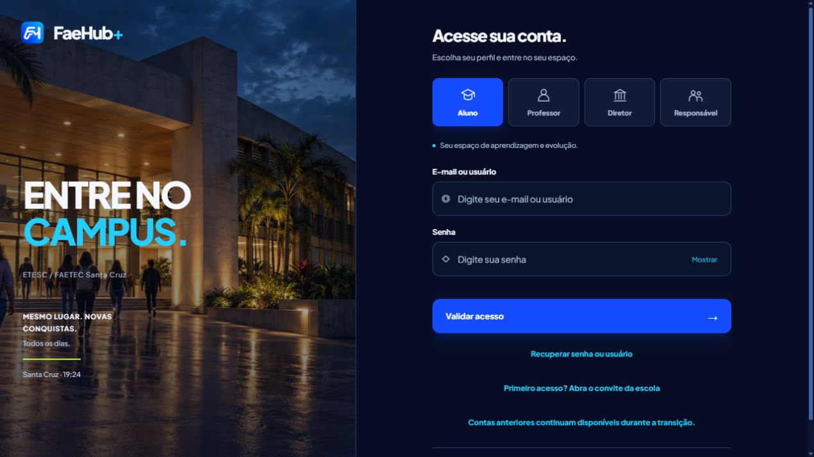

### Campos e controles

Perfil de acesso, E-mail ou usuário e Senha. O botão Mostrar permite conferir a senha sem alterá-la.

### Como utilizar

1. Abra o endereço público do FaeHub+ e escolha Aluno, Professor, Diretor ou Responsável.
2. Informe seu e-mail ou usuário e sua senha. Clique em Validar acesso.
3. Se a conta tiver autenticador ativo, conclua a segunda confirmação com o método oferecido.
4. Na confirmação de identidade, escolha Entrar no campus. Para encerrar, abra seu nome no cabeçalho e use Sair da conta.

### Regras e cuidados

Conta bloqueada, perfil incompatível ou credenciais inválidas não liberam as áreas protegidas. Não compartilhe sua sessão.

Em computador compartilhado, sair da conta é obrigatório; fechar uma aba não equivale a encerrar a sessão.

## Ativar uma conta por convite

Titular convidado | /ativar | UC02

O cadastro é autorizado pela escola. Não existe inscrição pública que permita escolher livremente um papel escolar. O titular confirma o e-mail e cria sua própria senha pelo convite recebido.

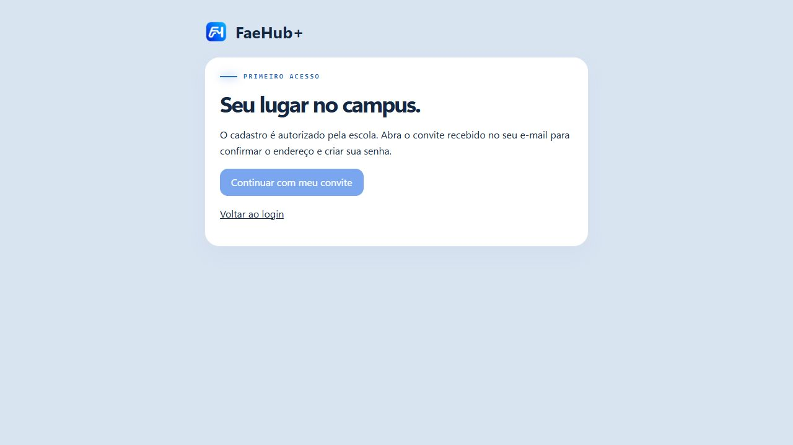

### Campos e controles

Convite válido recebido por e-mail, identificação do titular e campos de senha e confirmação disponibilizados pelo convite.

### Como utilizar

1. Peça à direção o cadastro com seu e-mail correto e os vínculos acadêmicos necessários.
2. Abra o link do convite na sua própria caixa de e-mail. A tela de Primeiro acesso sem convite não libera a continuação.
3. Confira a identidade apresentada, escolha uma senha entre 8 e 128 caracteres e repita a mesma senha.
4. Conclua a confirmação do e-mail e a ativação. Depois retorne ao login com as credenciais pessoais.

### Regras e cuidados

Convites expirados, usados, revogados ou não enviados não devem ser reutilizados; solicite um novo envio à escola.

A direção não precisa conhecer a senha escolhida. O convite depende de transporte de e-mail configurado e envio aceito.

## Recuperar senha ou nome de usuário

Titular com e-mail confirmado | /recuperar-senha | UC03

A recuperação utiliza apenas o e-mail confirmado da conta e não depende de aprovação da direção. A resposta pública é neutra para não revelar se um endereço está cadastrado.

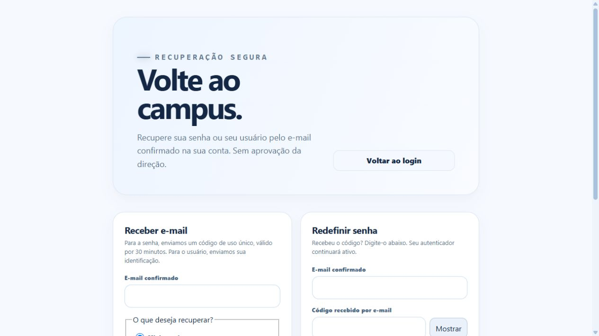

### Campos e controles

Receber e-mail: E-mail confirmado e Minha senha ou Meu usuário. Redefinição: e-mail, código recebido, nova senha e confirmação.

### Como utilizar

1. No login, clique em Recuperar senha ou usuário e informe o e-mail confirmado.
2. Escolha Meu usuário para receber sua identificação por e-mail, ou Minha senha para receber um código de uso único.
3. Para redefinir, informe o mesmo e-mail e o código mais recente, válido por 30 minutos. Digite e confirme a nova senha.
4. Conclua a redefinição e entre novamente. Confira o spam se a mensagem não aparecer na caixa de entrada.

### Regras e cuidados

Reenvio invalida o código anterior. Existem limites de tentativas; aguarde quando solicitado.

Redefinir a senha encerra sessões anteriores, mas preserva o autenticador, os papéis e os vínculos. Sem acesso ao e-mail, procure suporte privado; não há um atalho público de recuperação.

## Utilizar o autenticador da conta

Todos os titulares ativados | /conta/seguranca | UC04

Segurança da conta permite adicionar TOTP, compatível com Google Authenticator e outros aplicativos. É um segundo fator: o Gmail envia mensagens, enquanto o autenticador gera códigos no celular. São serviços diferentes.

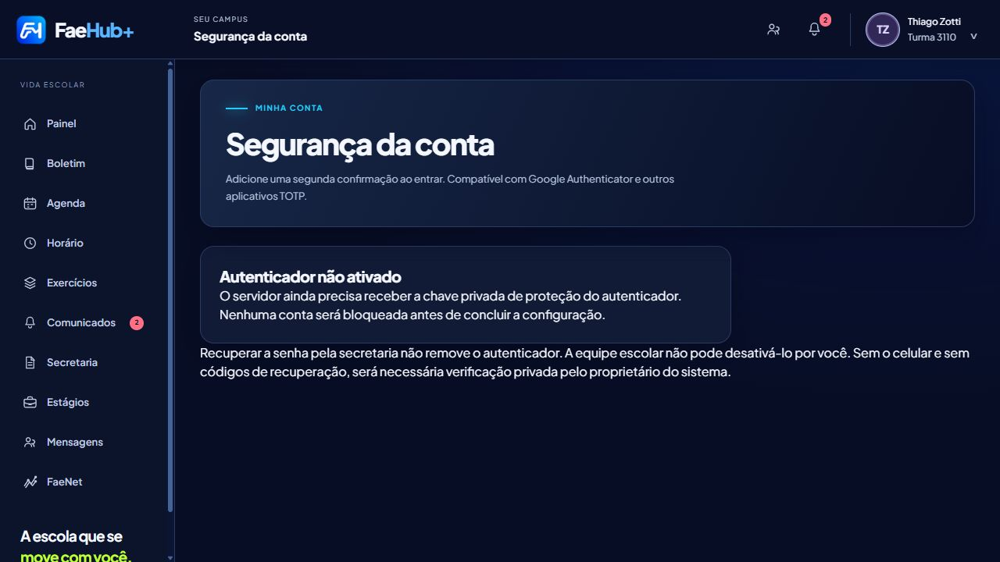

### Como utilizar

1. Abra seu nome no cabeçalho e selecione Segurança da conta. Confirme que o servidor está configurado e que sua conta foi ativada por e-mail.
2. Confirme a senha atual, leia o QR no autenticador ou cadastre a chave manualmente e confirme um código de seis dígitos antes da expiração de dez minutos.
3. Guarde os dez códigos de recuperação em local privado. Eles são exibidos uma vez e cada um pode ser usado apenas uma vez, junto com a senha.
4. Para gerar novos códigos ou desativar o recurso, use a opção correspondente e confirme senha e um código novo. Nunca envie QR ou códigos por mensagens.

### Regras e cuidados

A captura mostra o estado sem chave de proteção no ambiente local, não uma verificação da configuração de produção. Não é possível ativar enquanto essa pendência existir.

Perda do celular e de todos os códigos exige verificação privada pelo operador. Redefinir a senha por e-mail não remove TOTP; a direção não o desativa por outra pessoa.

## Navegar e personalizar a identificação

Todos os perfis | Cabeçalho e menu da conta

O menu lateral apresenta as áreas autorizadas. O cabeçalho reúne mensagens, comunicados ou notificações e o menu pessoal. A opção Pular para o conteúdo auxilia a navegação pelo teclado.

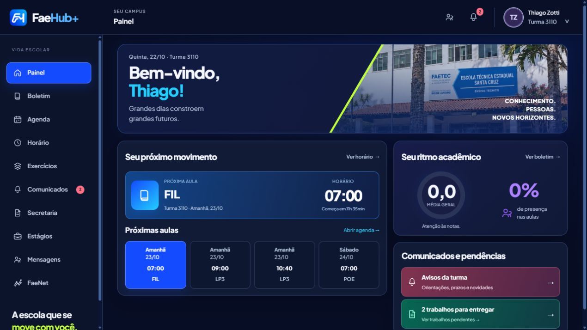

### Como utilizar

1. Escolha a seção desejada no menu. O título no cabeçalho informa onde você está.
2. Clique no nome da conta para encontrar Segurança da conta, Alterar foto de perfil e Sair da conta, nas telas que utilizam esse cabeçalho.
3. Em Alterar foto de perfil, escolha uma imagem permitida e confirme o envio apresentado pela interface. A foto identifica a conta; não altera nome, papel nem matrícula.
4. Use os botões de busca e os filtros de cada seção. Se uma lista estiver vazia, limpe os filtros antes de concluir que faltam registros.

### Regras e cuidados

Consultar uma tela não salva automaticamente os campos de um formulário. Use a ação Salvar, Enviar ou Publicar correspondente.

Em listas extensas, procure a rolagem da própria lista, a paginação e os controles ao final do formulário. Uma imagem da parte superior não representa necessariamente toda a página.

## Consultar o painel do aluno

Aluno | /painel | UC05

O painel resume a turma, a próxima aula, as aulas seguintes, o ritmo acadêmico e pendências. Os cartões são atalhos para as áreas de consulta e entrega, não substitutos do histórico detalhado.

### Como utilizar

1. Confira a identificação e a turma mostradas no início do painel.
2. Use Ver horário ou Abrir agenda para conferir disciplina, dia e início das próximas aulas.
3. Abra Ver boletim para analisar os lançamentos de notas. Confira a frequência na Agenda e seu histórico de chamadas.
4. Use Avisos da turma ou o cartão de trabalhos pendentes para abrir a lista correspondente.

### Regras e cuidados

Contadores refletem os registros disponíveis. Um painel com zero e sem chamadas não comprova ausência ou desempenho insuficiente.

As datas das capturas são do ensaio. Para preparar uma aula ou entrega, confira a data real de acesso e os registros publicados.

## Ler e imprimir o Boletim

Aluno | /boletim | UC06

O Boletim apresenta Nota 1, Nota 2, média e situação por disciplina. O resumo reúne a média dos lançamentos disponíveis, a quantidade de disciplinas com notas e as que estão em recuperação.

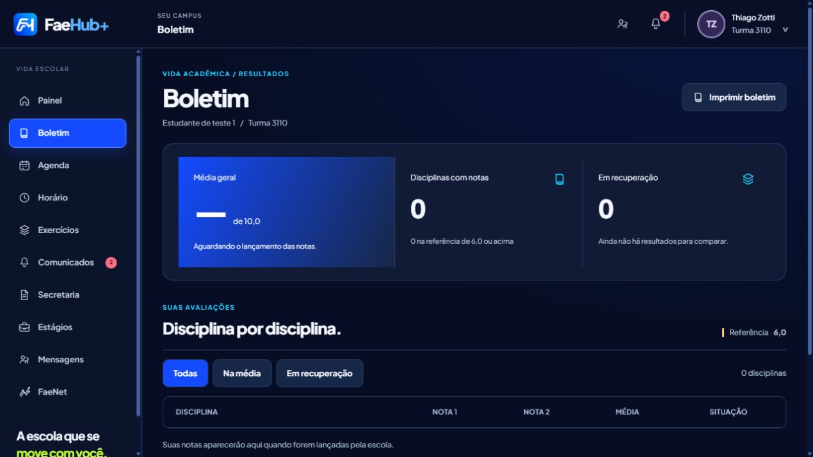

### Como utilizar

1. Abra Boletim e confirme o estudante e a turma. Na tabela, compare N1, N2 e a média de cada disciplina.
2. Use Todas, Na média ou Em recuperação para filtrar. A referência exibida é 6,0 e a média da disciplina é (N1 + N2) / 2.
3. Abra Simular uma média para experimentar valores. A simulação não altera o boletim oficial nem grava notas.
4. Use Imprimir boletim para abrir a impressão do navegador e escolher uma impressora ou Salvar como PDF.

### Regras e cuidados

O piloto visual da captura mostra barras de 0 a 10 com referência em 6,0. Sem lançamento, apresenta traço e mensagem de espera.

O fluxo atual de N1/N2 não é dividido por bimestre. A impressão desta consulta não substitui documento oficial emitido pela instituição.

## Acompanhar Agenda e frequência

Aluno | /agenda e /frequencia?base=diaria | UC07

A Agenda reúne o calendário de presenças, os eventos visíveis para a turma e as chamadas do mês, com disciplina e horário. O histórico diário anterior fica separado da nova frequência por aula.

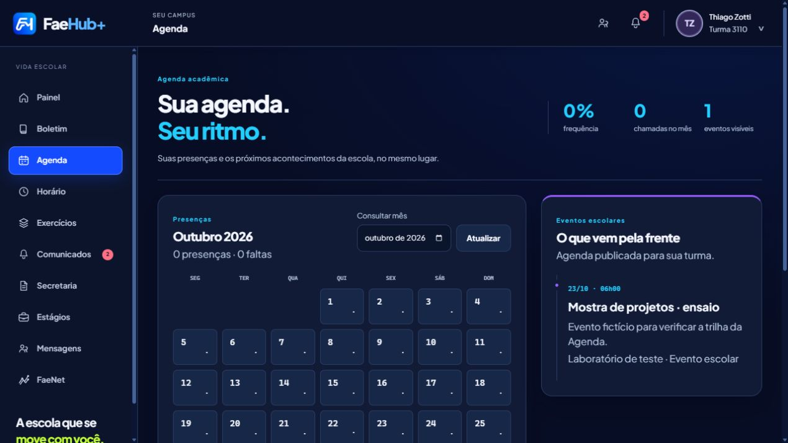

### Como utilizar

1. Abra Agenda, escolha o mês em Consultar mês e clique em Atualizar.
2. Selecione um dia para consultar o registro; confira as chamadas por disciplina e horário na lista do mês.
3. Leia os próximos eventos e observe o público, a data e o local publicados.
4. Se precisar de registros antigos, abra Histórico diário anterior. Use Consultar por aula para retornar à base atual.

### Regras e cuidados

Ausência de chamada não é falta. Um mesmo dia pode reunir presenças e faltas em aulas distintas e aparecer com indicação mista.

Quando há registros por aula, essa base é usada no percentual. Sem eles, o sistema mantém a base diária anterior; não soma dias e aulas no mesmo denominador.

Na amostra local foi observada diferença entre horário bruto do evento e o apresentado na Agenda. Confirme o fuso com a escola em caso de divergência; não corrija o compromisso por conta própria.

## Interpretar a grade de horários

Aluno | /horario | UC08

A grade organiza as aulas publicadas por dia, início e término. Exibe também períodos sem aula cadastrada e identifica o docente quando há vínculo correspondente.

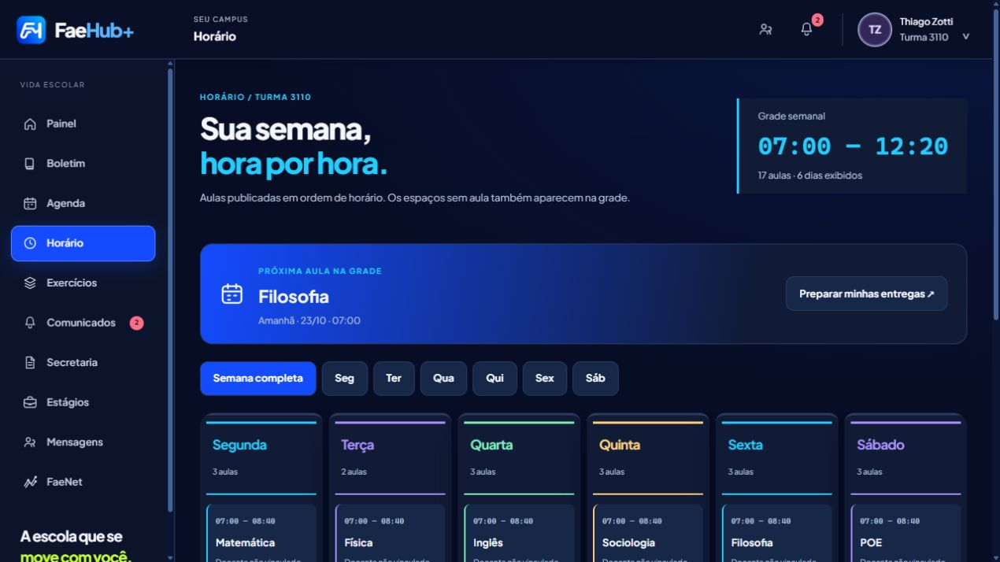

### Como utilizar

1. Abra Horário e confira a turma, o período abrangido e a próxima aula na grade.
2. Escolha Semana completa ou um dia específico para reduzir a visualização.
3. Leia cada bloco com início, término, disciplina e docente. Diferencie blocos de aula de Sem aula ou Tempo livre.
4. Use Preparar minhas entregas para ir a Exercícios. Havendo divergência na grade, informe a secretaria.

### Regras e cuidados

Tempo livre significa ausência de aula publicada; não afirma que esse período seja um intervalo oficial.

Segunda a sexta compõem a referência semanal. Sábado ou domingo só aparecem se houver aula publicada nesse dia. A captura contém sábado porque há aulas cadastradas.

Docente não vinculado indica falta de vínculo no cadastro, não autorização para escolher um professor substituto.

## Buscar atividades e consultar devolutivas

Aluno | /exercicios | UC09

Exercícios reúne atividades ativas da turma, prazo, enunciado, anexos e situação da entrega. A busca e os filtros ajudam a separar o que ainda precisa ser feito do que já foi enviado.

### Como utilizar

1. Abra Exercícios e procure pelo título. Use Todas, Pendentes ou Entregues para restringir a lista.
2. Clique em Abrir atividade para ler o enunciado completo, os materiais e a data de entrega.
3. Depois do envio, retorne à atividade para conferir sua resposta, o anexo e uma eventual correção do professor.
4. Se o professor solicitar ajuste, revise a resposta com cuidado e confirme o novo envio pelo formulário.

### Regras e cuidados

Prazo encerrado é um aviso. A interface permite entrega tardia, mas a aceitação depende do professor.

A nota da atividade e o feedback não lançam N1/N2 automaticamente. Essa consolidação é feita pelo professor em Lançar notas.

Se a resposta mudar depois da correção, a entrega precisa ser revisada novamente. Arquivar a publicação não apaga entregas.

## Entregar uma atividade com anexo

Aluno | /exercicios → Abrir atividade | UC10

O formulário permite responder por texto, informar o link do trabalho ou anexar um arquivo. A entrega só é gravada após a ação explícita de envio.

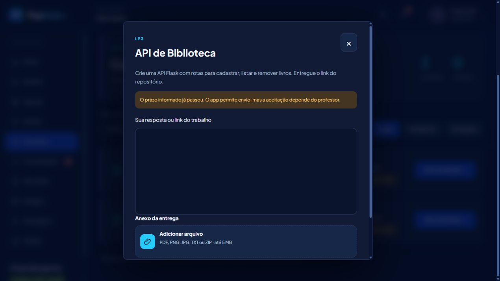

### Campos e controles

Sua resposta ou link do trabalho e Anexo da entrega. Formatos informados: PDF, PNG, JPG, TXT ou ZIP, até 5 MB.

### Como utilizar

1. Abra a atividade correta e leia suas instruções antes de preencher a resposta.
2. Digite o texto ou link solicitado. Para anexar, clique em Adicionar arquivo e escolha um arquivo dentro dos formatos e do tamanho permitidos.
3. Confira o nome do arquivo selecionado. Não envie documentos pessoais desnecessários ou links sem permissão de leitura para o professor.
4. Clique em Entregar atividade e confira a confirmação e a situação de entregue. Reabra para verificar o que ficou salvo.

### Regras e cuidados

É necessária uma resposta ou um anexo. Escolher um arquivo sem concluir o envio não cria uma entrega.

Arquivo inválido ou acima do limite deve ser substituído. Não renomeie uma extensão para tentar contornar a validação.

Em erro de conexão, consulte a atividade antes de reenviar; não presuma sucesso apenas porque o botão foi pressionado.

## Ler e organizar os Comunicados

Aluno | /comunicados | UC11

A central separa Avisos da turma, publicados por professores, de Atualizações da conta, geradas por serviços do sistema. A leitura fica persistida por conta.

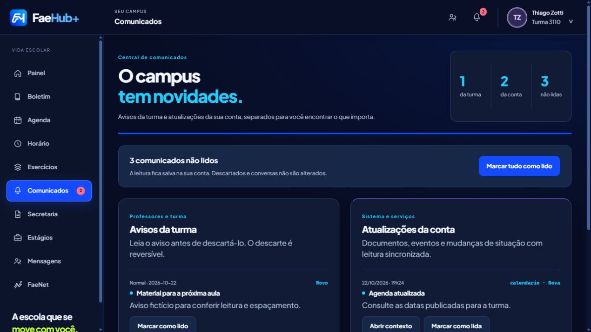

### Como utilizar

1. Abra Comunicados e leia o conteúdo de cada aviso ou atualização.
2. Use Marcar como lido ou Marcar como lida para registrar a leitura de um item.
3. Para registrar a leitura dos itens elegíveis de uma vez, use Marcar tudo como lido.
4. Nas atualizações, Abrir contexto leva ao documento, evento ou área relacionada. Quando disponível, o descarte de aviso pode ser desfeito.

### Regras e cuidados

Marcar tudo como lido não apaga itens e não altera conversas de Mensagens nem comunicados descartados.

O estado é do usuário autenticado; ler por uma conta não marca os itens como lidos para a turma inteira.

Se um contador divergir de outra área, atualize a tela e confira se está comparando avisos da turma, atualizações ou mensagens.

## Solicitar e acompanhar documentos

Aluno e responsável autorizado | /secretaria | UC12

A Secretaria digital registra pedidos por matrícula e disponibiliza um protocolo de acompanhamento. O aluno consulta a própria matrícula; o responsável seleciona uma das matrículas vinculadas.

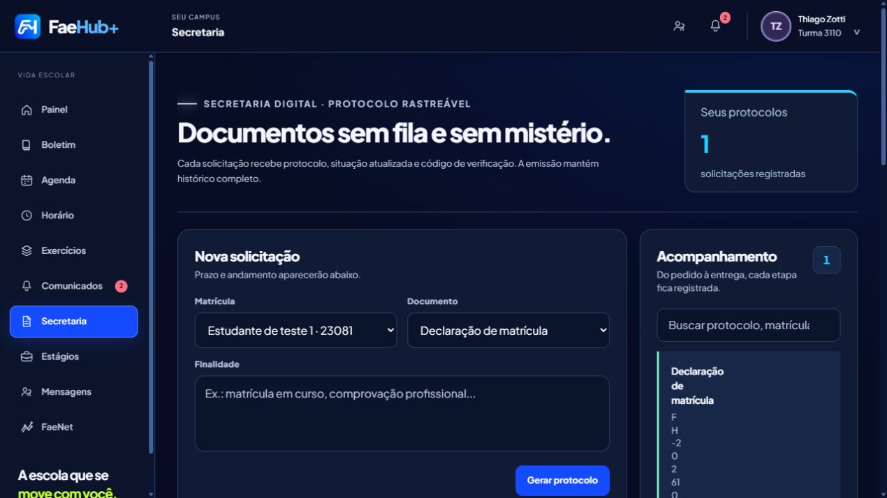

### Campos e controles

Matrícula, Documento e Finalidade. Tipos: declaração de matrícula, declaração de frequência, histórico escolar e ficha individual.

### Como utilizar

1. Abra Secretaria, confira a matrícula e selecione o tipo de documento.
2. Informe a finalidade e clique em Gerar protocolo. Anote o protocolo apresentado.
3. Acompanhe a situação e as observações da escola em Acompanhamento.
4. Quando a situação permitir, clique em Abrir. No documento emitido, use Imprimir / salvar PDF e confira a identificação do estudante.

### Regras e cuidados

As situações incluem Solicitado, Em processamento, Pronto, Entregue e Indeferido. Pronto não significa que o documento já foi retirado.

O identificador do documento é interno. Não há, neste fluxo, uma consulta pública de autenticidade comprovada nem assinatura digital qualificada.

Histórico acadêmico da Secretaria preserva anos e turmas. A consulta não autoriza alterar resultados.

## Consultar oportunidades de estágio

Aluno | /estagios | UC13

Estágios apresenta oportunidades divulgadas pelos professores para a turma. O app funciona como mural de anúncios e não como sistema de contratação ou garantia de vaga.

### Como utilizar

1. Abra Estágios e use a busca por oportunidade.
2. Filtre por Todas, Presencial, Híbrido ou Remoto. Confira o prazo de inscrição.
3. Abra o anúncio para ler empresa, descrição, requisitos, local, carga horária e instruções.
4. Inscreva-se pelo link ou canal indicado pelo anúncio, depois de verificar a confiabilidade do destino.

### Regras e cuidados

Uma lista vazia pode indicar ausência de publicações ou filtros restritivos. Use Limpar filtros.

Não há inscrição acadêmica automática nem envio de currículo pelo FaeHub+ neste mural.

A confirmação e o tratamento dos dados enviados em sites externos são responsabilidade dos respectivos canais. Não forneça senhas do FaeHub+ a uma empresa.

## Conversar com pessoas e grupos

Todos os perfis conforme contatos autorizados | /mensagens | UC14

Mensagens reúne conversas individuais e grupos autorizados, com busca e envio de texto ou anexo. Conversas da FaeHub+ não são as mesmas conversas da FaeNet.

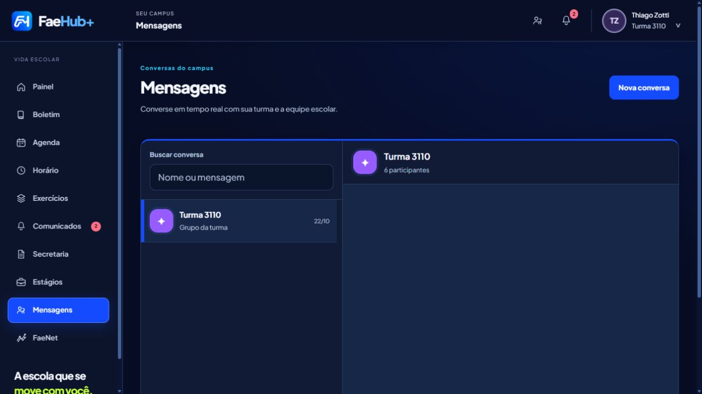

### Como utilizar

1. Abra Mensagens. Escolha uma conversa existente ou clique em Nova conversa.
2. Em uma nova conversa, selecione uma pessoa da lista permitida e escreva a mensagem. Para a turma, abra o grupo correspondente.
3. Use Adicionar foto ou arquivo ou Anexar para escolher uma imagem, PDF, TXT ou ZIP permitido. Confira a seleção e clique em Enviar.
4. Use a busca para reencontrar conversas. Abra a conversa para acompanhar as respostas e os indicadores de leitura disponibilizados.

### Regras e cuidados

A interface informa otimização de imagens antes do envio e limite de até 5 MB para demais arquivos. O servidor também valida o arquivo.

Quando presentes, reações e indicadores de entrega ou leitura pertencem à conversa; não substituem a leitura dos Comunicados.

Responsável não recebe uma lista irrestrita de contatos. Falha de rede pode interromper atualizações; confira o histórico antes de repetir um envio.

## Gerenciar notificações da conta

Professor direção e responsável | /notificacoes | UC15

A central reúne atualizações acadêmicas e administrativas visíveis para a conta, com estado de leitura persistente. Para o aluno, a central de Comunicados reúne os avisos e as atualizações de forma integrada.

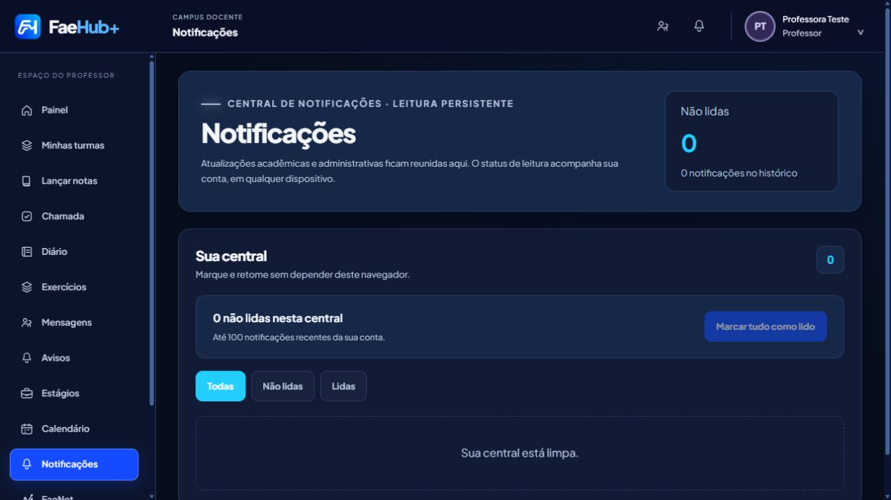

### Como utilizar

1. Abra Notificações no menu ou pelo sino do cabeçalho.
2. Use Todas, Não lidas e Lidas para consultar o histórico apresentado.
3. Abra o contexto de uma atualização quando houver um atalho para a área de origem.
4. Marque um item como lido ou utilize Marcar tudo como lido para os itens elegíveis da sua central.

### Regras e cuidados

A tela informa até 100 notificações recentes. O botão em lote pode ficar desabilitado quando não há itens não lidos.

Leitura não é exclusão. A ação não modifica as notificações de outros usuários nem as mensagens de uma conversa.

A criação de comunicados institucionais, quando permitida à direção, precisa respeitar o público e os campos oferecidos na própria tela.

## Organizar o trabalho pelo painel docente

Professor | /painel | UC16

O painel docente resume turmas vinculadas, disciplinas, alunos, entregas a corrigir e próximas aulas. Os atalhos conduzem às ações de registro e publicação.

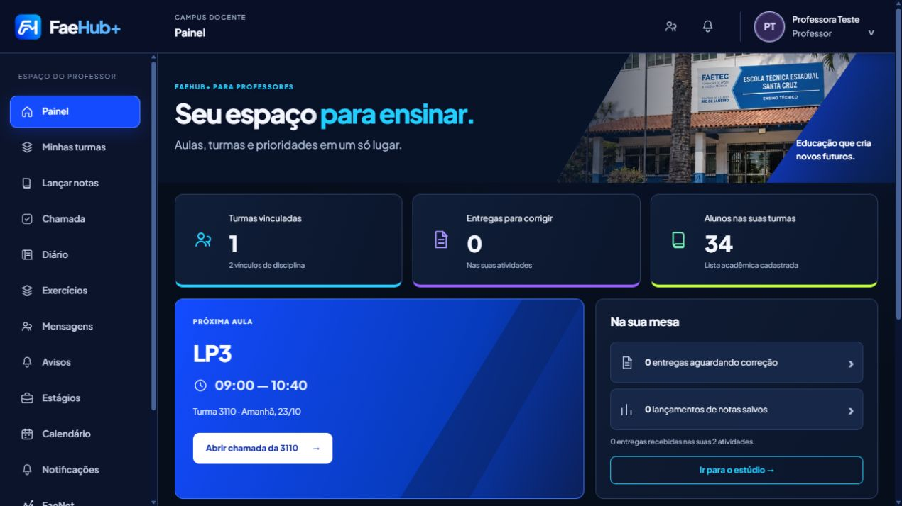

### Como utilizar

1. Confira os totais de turmas e vínculos, sem confundir número de alunos com quantidade de contas de login.
2. Em Próxima aula, use Abrir chamada para iniciar o registro da turma correspondente.
3. Consulte Na sua mesa para abrir as entregas a corrigir e os lançamentos já salvos.
4. Use os atalhos Lançar notas, Registrar frequência e Criar atividade. Em Minhas turmas, confirme os componentes atribuídos.

### Regras e cuidados

Os vínculos são administrados pela direção. Uma turma ausente do painel não deve ser acessada usando a conta de outro professor.

O próximo horário previsto não é uma chamada já salva. A frequência depende do registro explícito por aula.

## Consultar as turmas vinculadas

Professor | /turmas | UC17

Minhas turmas organiza a lista de estudantes e as disciplinas atribuídas à conta docente. A busca auxilia a localizar um estudante antes de registrar notas ou presença.

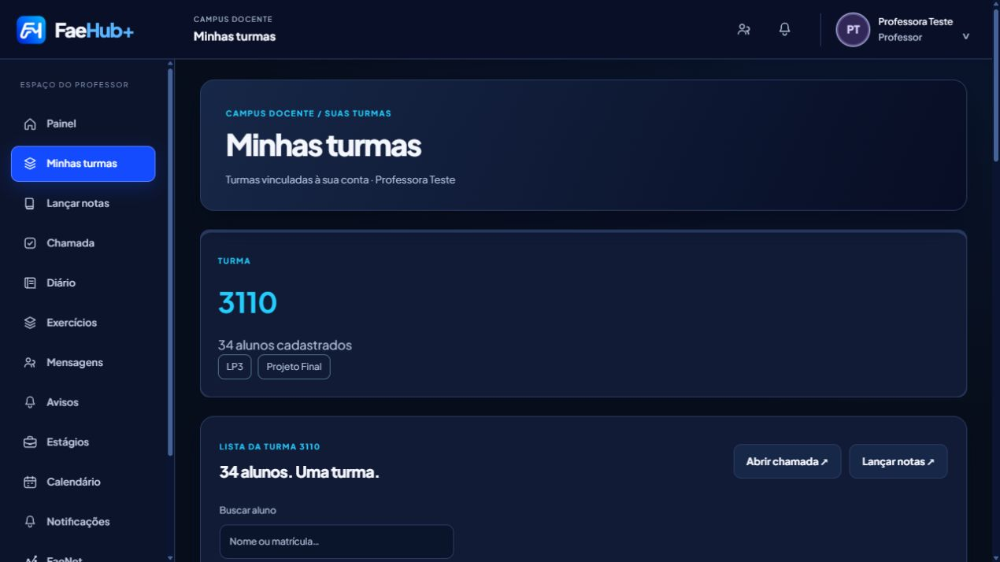

### Como utilizar

1. Abra Minhas turmas e selecione a turma disponível.
2. Confira a quantidade de alunos e os componentes curriculares vinculados.
3. Use Buscar aluno para localizar nome ou matrícula na lista.
4. Use Abrir chamada, Lançar notas ou o atalho Notas do estudante para abrir o contexto apropriado.

### Regras e cuidados

A lista corresponde ao cadastro acadêmico. Vínculo de usuário e matrícula escolar são informações distintas.

Mudanças de composição da turma devem ser tratadas na Estrutura acadêmica pela direção, preservando a trajetória anterior.

## Lançar e corrigir notas

Professor com vínculo válido | /notas | UC18

A tela seleciona turma e disciplina e permite salvar N1 e N2 para cada aluno. A média durante a edição é uma prévia; o botão de uma linha salva somente aquele estudante e disciplina.

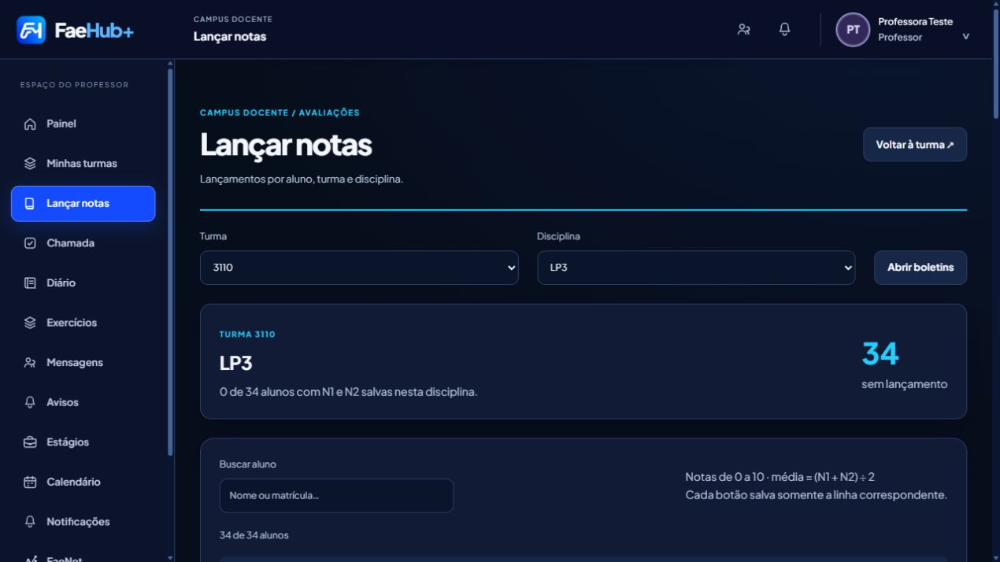

### Campos e controles

Turma, Disciplina, busca de aluno e notas N1 e N2 de 0 a 10. Média = (N1 + N2) / 2.

### Como utilizar

1. Selecione a turma e a disciplina e clique em Abrir boletins.
2. Localize o aluno pela busca e confira sua matrícula.
3. Preencha N1 e N2, confira a média prevista e clique em Salvar na mesma linha.
4. Após a confirmação, consulte o registro novamente. Repita a ação para outros estudantes; não presuma que salvar uma linha gravou todas.

### Regras e cuidados

Não há divisão por bimestre no lançamento atual. A nota de uma correção de exercício não é copiada automaticamente para N1/N2.

Notas de outras disciplinas não são sobrescritas por esse envio. Períodos fechados e vínculos inválidos podem impedir alterações.

Campo vazio ou Sem lançamento não deve ser interpretado como nota zero atribuída pela escola.

## Realizar a chamada por aula

Professor com vínculo vigente | /chamada | UC19

Cada disciplina e início de aula têm uma chamada independente. O dia sozinho não identifica o registro. Alterar a seleção de alunos não grava dados até usar Salvar chamada desta aula.

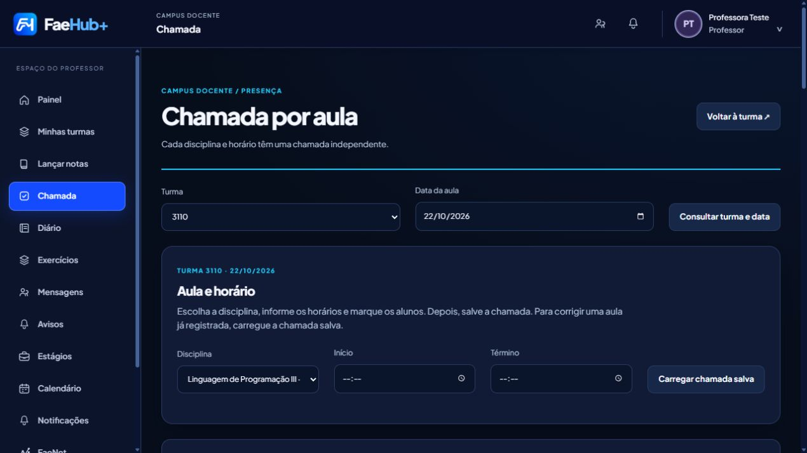

### Campos e controles

Turma, Data da aula, Disciplina, Início e Término; seleção Presente ou Ausente por estudante.

### Como utilizar

1. Consulte turma e data. Selecione a disciplina e informe início e término da aula no horário da escola.
2. Para corrigir uma chamada existente, use Carregar chamada salva antes de editar.
3. Marque todos os estudantes. O atalho Marcar os alunos como presentes preenche a turma; depois marque as exceções como Ausente. A busca não reduz a obrigação de conferir a turma inteira.
4. Revise os contadores de presentes, ausentes e sem marcação. Clique em Salvar chamada desta aula e confirme os registros ao recarregar a mesma seleção.

### Regras e cuidados

A aula não pode ser futura, sobreposta, fora da matrícula ou sem vínculo docente vigente. Turma e ano devem estar ativos e a data deve ter um único período aberto.

Restaurar seleção inicial reverte a edição local, não exclui uma chamada salva. Edição concorrente exige recarregar; uma janela antiga não deve sobrescrever outra.

Aulas diferentes do mesmo dia continuam independentes. Não há neste formulário registro de atraso ou abono especial: as opções disponíveis são Presente e Ausente.

## Registrar e enviar o Diário

Professor | /diario | UC20

O Diário registra o conteúdo pedagógico de uma aula e permite guardar rascunho ou enviá-lo à validação. Ele não substitui a chamada de presença.

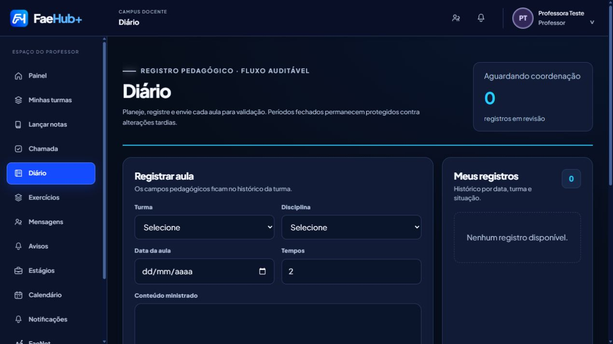

### Campos e controles

Turma, Disciplina, Data da aula, Tempos, Conteúdo ministrado, Objetivos, Metodologia, Recursos, Atividade para casa e Observações.

### Como utilizar

1. Selecione turma, disciplina e data; informe os tempos de aula.
2. Descreva conteúdo e objetivos e complete os demais campos pedagógicos necessários.
3. Use Salvar rascunho se o registro ainda estiver em elaboração, ou Enviar para validação quando estiver concluído.
4. Acompanhe Meus registros. Caso seja devolvido com ajustes, leia a observação, corrija o registro permitido e envie novamente.

### Regras e cuidados

As situações do fluxo incluem Rascunho, Em validação, Validado e Ajustes solicitados.

Registros em período fechado ficam protegidos contra alterações tardias. A equipe autorizada decide sobre validação ou devolução.

Não registre informações pessoais ou sensíveis sem necessidade pedagógica e autorização apropriada.

## Publicar atividades e corrigir entregas

Professor | /exercicios | UC21

O estúdio permite criar, editar, arquivar, restaurar e consultar entregas das próprias atividades. O arquivamento preserva o histórico, em vez de apagar respostas de alunos.

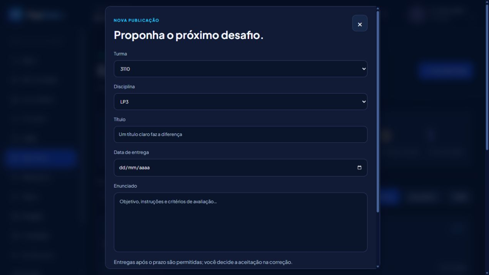

### Campos e controles

Criação: turma, disciplina, título, data de entrega, enunciado e anexo opcional. Correção: nota da atividade de 0 a 10 e feedback.

### Como utilizar

1. Use Criar atividade e selecione uma turma e disciplina vinculadas. Informe título, prazo e instruções; anexe material se necessário.
2. Clique em Publicar para os alunos. Depois, utilize a busca e os filtros Ativos, Arquivados ou Todos.
3. Abra Ver entregas e expanda o aluno. Leia resposta e arquivos, atribua a nota da atividade, escreva feedback e salve a correção.
4. Para retirar a atividade da lista ativa, use Arquivar. No filtro Arquivados, a ação de restauração permite reativá-la.

### Regras e cuidados

Só o autor gerencia sua publicação. Alterar a resposta após a correção exige nova revisão; o formulário protege a referência da resposta corrigida.

Correções não alteram N1/N2 automaticamente. Consolide os resultados em Lançar notas conforme a regra pedagógica da escola.

A tela de entregas vazia mostra que ainda não houve respostas, não que a publicação falhou.

## Publicar e arquivar avisos da turma

Professor | /avisos | UC22

Avisos permite manter o mural da turma sem misturar publicações docentes com notificações administrativas ou conversas individuais.

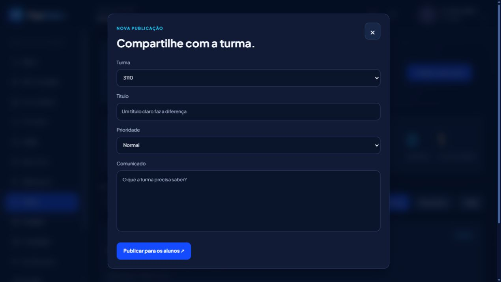

### Campos e controles

Turma, Título, Prioridade Normal ou Importante e texto do Comunicado.

### Como utilizar

1. Abra Avisos e clique em Novo comunicado.
2. Selecione a turma vinculada, escreva título e conteúdo e defina a prioridade.
3. Publique e confira a mensagem na lista de ativos. Use Editar para revisar uma publicação sua.
4. Arquive um comunicado que não deva continuar ativo. Use o filtro Arquivados e a restauração para disponibilizá-lo novamente.

### Regras e cuidados

Alunos veem avisos ativos da própria turma. Prioridade não concede acesso a outras turmas.

Somente o autor edita ou arquiva os seus avisos. A leitura do aluno é registrada separadamente por conta.

Use linguagem objetiva, datas completas e instruções claras. Não publique senhas ou dados pessoais desnecessários.

## Publicar oportunidades profissionais

Professor | /estagios | UC23

A publicação de oportunidade associa um anúncio à turma e define como o aluno pode buscar informações ou se inscrever.

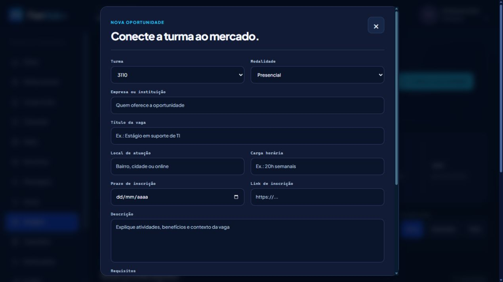

### Campos e controles

Turma, modalidade, empresa, título da vaga, local, carga horária, prazo, link, descrição, requisitos e instruções de inscrição.

### Como utilizar

1. Clique em Publicar oportunidade e selecione uma turma vinculada.
2. Preencha os dados da empresa e da vaga, o prazo e a modalidade Presencial, Híbrido ou Remoto.
3. Informe um link seguro ou instruções de inscrição e publique para os alunos.
4. Use busca e filtros de modalidade e visibilidade. Edite, arquive ou restaure suas publicações quando houver mudança de prazo ou disponibilidade.

### Regras e cuidados

É obrigatório fornecer link seguro ou instruções utilizáveis. Confirme a legitimidade da empresa antes de divulgar.

O sistema não executa seleção, contratação, envio de currículo ou confirmação automática de inscrição.

O autor é responsável por manter o anúncio correto. Arquivar preserva o registro e deixa de apresentá-lo como oportunidade ativa.

## Acompanhar o observatório da direção

Direção | /painel | UC24

O painel administrativo apresenta alunos cadastrados, contas ativas, professores, turmas, filas de atendimento, calendário e vínculos da equipe.

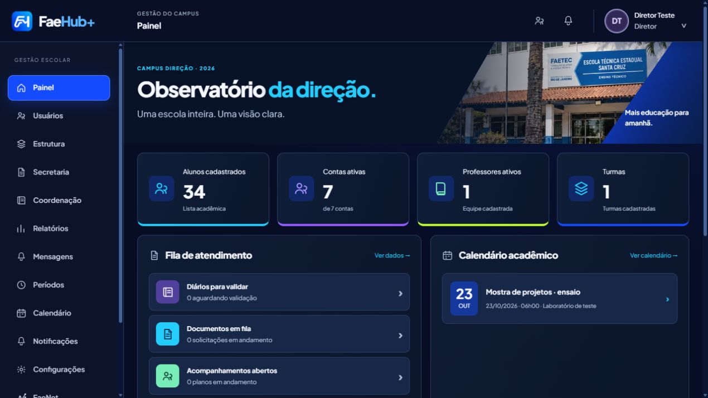

### Como utilizar

1. Confira os totais e diferencie cadastro acadêmico, conta de acesso e vínculo docente.
2. Na Fila de atendimento, abra diários a validar, documentos em andamento ou acompanhamentos abertos.
3. Consulte calendário e panorama das turmas para localizar o contexto da atividade escolar.
4. Use Gerenciar comunidade para Usuários ou Ver relatórios para exportações e trilha de atividade.

### Regras e cuidados

Os indicadores vêm de registros salvos. Sem registros não há uma tendência estatística comprovada.

O painel é uma síntese; use as listas e os relatórios para confirmar o recorte e a abrangência antes de tomar decisões.

## Gerenciar contas e convites

Direção ativada e proprietário conforme autorização | /usuarios | UC25

Usuários organiza identidades e acesso, com busca, filtro por perfil, preparação de convites e gerenciamento das contas. O cadastro acadêmico de um estudante é mantido na Estrutura.

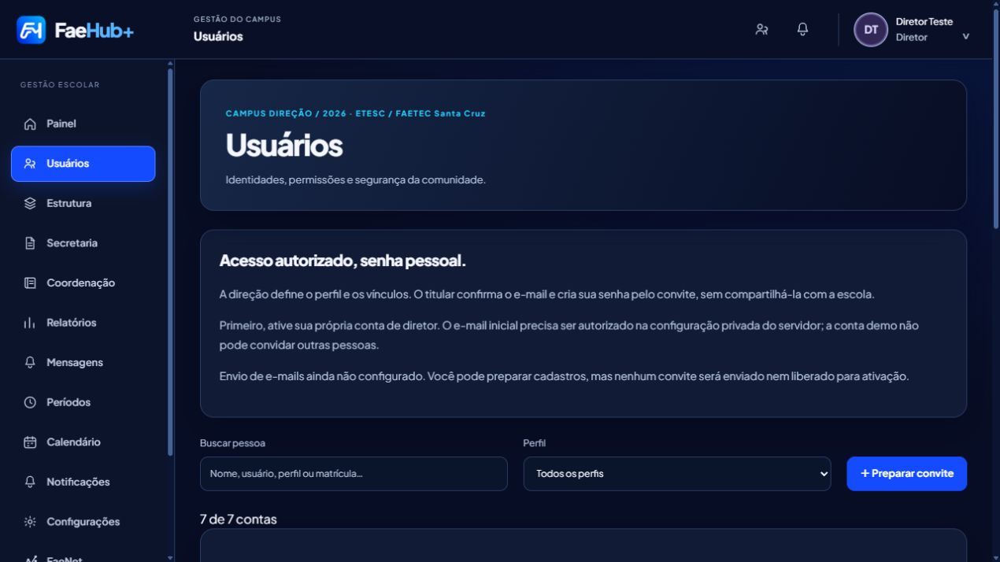

### Como utilizar

1. Confirme que sua conta de direção está ativada e que o envio de e-mail está configurado.
2. Use Preparar convite para cadastrar a identificação e o perfil correto, com e-mail do titular e vínculos exigidos pelo formulário.
3. Em Gerenciar, confira os dados da conta antes de aplicar alterações, reenviar ou revogar um convite ou alterar a situação permitida.
4. Utilize busca e filtro de perfil para conferir a comunidade. A ação Encerrar contas de demonstração só deve ser usada após garantir o acesso pessoal da direção.

### Regras e cuidados

Preparar um cadastro não garante envio de convite. Sem transporte de e-mail, a própria tela informa que a ativação não foi liberada.

A conta demo não pode convidar outras pessoas como se fosse uma identidade confirmada.

Encerrar demonstrações bloqueia contas demo não convertidas, preservando registros. Não altera contas que já foram ativadas pessoalmente.

Bloqueios e mudanças de permissão afetam acesso. Não utilize estas ações apenas para experimentar durante uma apresentação.

## Organizar a estrutura acadêmica

Direção | /estrutura | UC26

Estrutura conecta anos e períodos, cursos, disciplinas, turmas, matrículas, professores e horários. O Mapa mostra o inventário e a sequência de dependências dos cadastros.

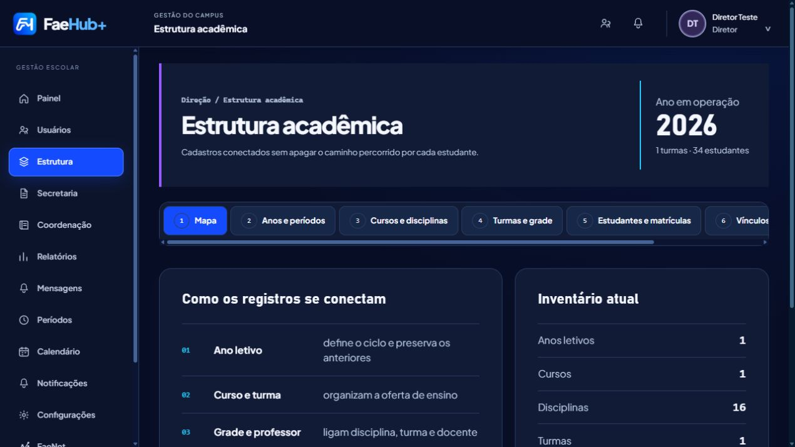

### Como utilizar

1. Abra Estrutura e consulte o Mapa para conhecer os cadastros já existentes.
2. Use Anos e períodos para criar o ciclo letivo, delimitar suas datas e cadastrar os períodos dentro desse ano.
3. Defina cursos e disciplinas, depois crie turmas e associe seus componentes.
4. Cadastre estudantes e matrículas e, por fim, os vínculos docentes e os horários. Use Consultar históricos para recuperar uma trajetória anterior.

### Regras e cuidados

Alterar a situação não significa apagar registros. Ano, turma e matrícula encerrados continuam disponíveis para histórico.

Um curso ou disciplina reutilizável não deve ser recriado a cada consulta. Confira o código antes de cadastrar duplicatas.

O ano de referência em Configurações não substitui o cadastro estrutural de um novo ano letivo.

## Cadastrar anos e períodos letivos

Direção | /estrutura?view=years | UC26

A área apresenta a linha do tempo dos anos e seus períodos. Cada ciclo tem datas e situação próprias, preservando os anteriores.

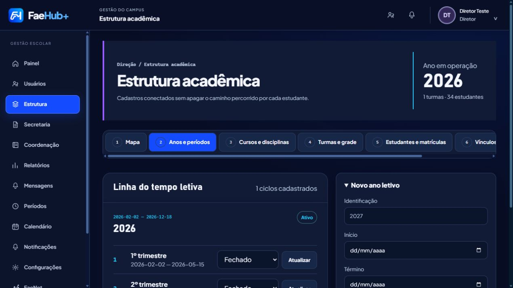

### Campos e controles

Ano: identificação, início e término. Período: ano, identificação, ordem e datas no respectivo ciclo. Situações apresentadas na interface.

### Como utilizar

1. Em Novo ano letivo, informe identificação e intervalo de datas e use Criar ano.
2. Abra Novo período e associe-o ao ano correto, com ordem e datas coerentes.
3. Confira na linha do tempo os períodos e a situação do ano antes de atualizar.
4. Para um fechamento ou reabertura operacional, use Períodos e registre uma justificativa auditável.

### Regras e cuidados

Não abra períodos conflitantes para a mesma data de chamada. O registro de frequência exige um único período aberto.

Planejamento, Ativo, Fechado e Arquivado são estados do ano; Planejamento, Aberto e Fechado são estados de período.

Não trate alteração de ano como reinicialização de notas ou exclusão do histórico.

## Manter cursos e disciplinas

Direção | /estrutura?view=catalog | UC26

O catálogo pedagógico mantém cursos e disciplinas reutilizáveis entre anos. Uma disciplina só passa a compor uma turma após o vínculo na grade dessa turma.

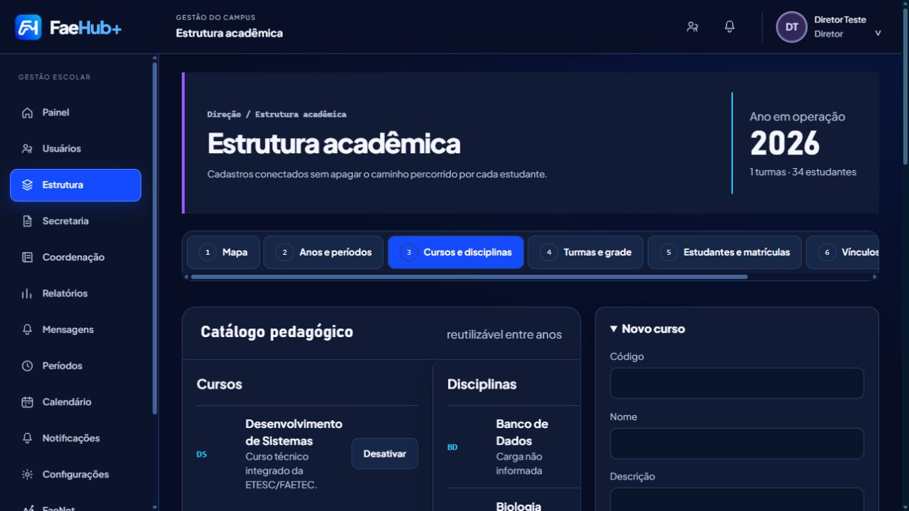

### Campos e controles

Curso: código, nome e descrição. Disciplina: código, nome e carga horária quando informada no cadastro.

### Como utilizar

1. Consulte os códigos e nomes existentes para evitar duplicação.
2. Use Novo curso ou Nova disciplina, preencha os campos e confirme a criação.
3. Vincule a disciplina à turma em Turmas e grade; o simples cadastro no catálogo não faz essa associação.
4. Para deixar de utilizar um item, use a ação de desativação ou ativação correspondente, preservando os vínculos históricos.

### Regras e cuidados

Desativar não equivale a excluir resultados passados. Não reutilize o código de uma disciplina para dar outro significado a registros antigos.

Carga não informada indica ausência desse dado; não significa uma carga horária de zero.

## Cadastrar turmas e compor grades

Direção | /estrutura?view=classes | UC26

Cada turma pertence a um ano letivo e pode estar associada a um curso. A grade curricular define as disciplinas oferecidas nessa turma; os horários semanais são publicados em uma área separada.

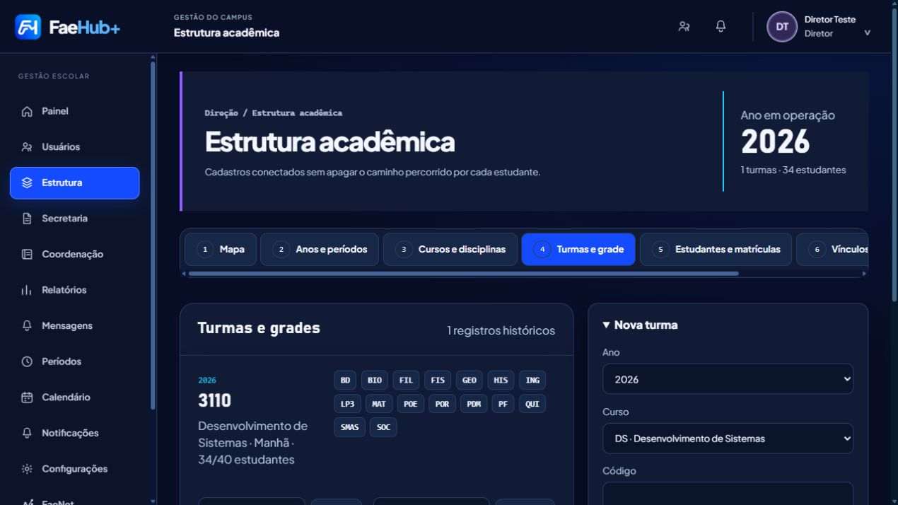

### Campos e controles

Ano, Curso, Código, Etapa, Turno, Sala, Capacidade e situação da turma. Grade: disciplina a vincular.

### Como utilizar

1. Em Nova turma, selecione ano e curso e informe identificação, etapa, turno, sala e capacidade.
2. Crie a turma e confira o registro no inventário.
3. Na turma correta, escolha uma disciplina do catálogo e clique em Vincular. Repita para os demais componentes.
4. Salve alterações de situação apenas após verificar matrículas e operação do ano. Depois configure os vínculos docentes e horários.

### Regras e cuidados

Grade curricular não é grade de horários: adicionar disciplina não define dia nem início da aula.

Planejamento, Ativo, Fechado e Arquivado controlam o ciclo da turma. Encerramento preserva o histórico.

Uma nova turma não cria automaticamente contas para seus estudantes nem concede acesso a professores.

## Cadastrar estudantes e matrículas

Direção | /estrutura?view=students | UC27

Estudante é a pessoa no cadastro acadêmico; matrícula relaciona essa pessoa a uma turma e a um período de vínculo. Conta de acesso é outro registro, que pode ser associado à identificação escolar.

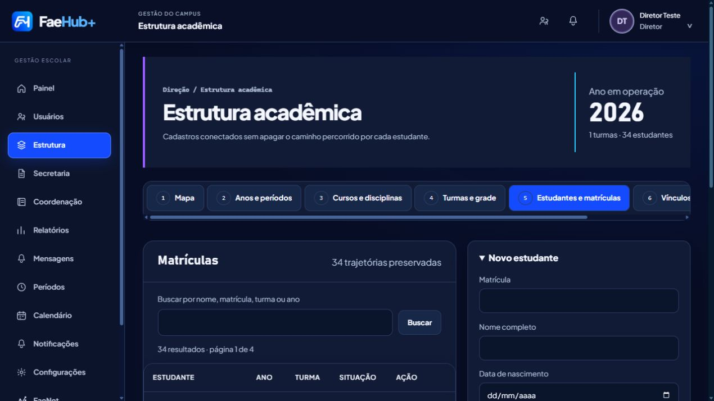

### Campos e controles

Estudante: matrícula de identificação, nome completo e data de nascimento. Matrícula na turma: estudante, turma e data de ingresso. Encerramento: situação e data conforme formulário.

### Como utilizar

1. Pesquise por nome, matrícula, turma ou ano e percorra a paginação antes de criar um novo registro.
2. Cadastre o estudante quando ele ainda não existir no diretório.
3. Abra Nova matrícula e relacione o estudante à turma correta, com a data adequada.
4. Quando necessário, utilize Encerrar e informe o motivo ou situação de saída oferecida. Consulte o histórico para conferir a trajetória preservada.

### Regras e cuidados

O modelo mantém uma matrícula ativa por estudante. Transferência ou conclusão não deve apagar a matrícula anterior.

Datas de ingresso e encerramento determinam a elegibilidade para chamadas históricas.

Criar estudante ou matrícula não equivale a enviar convite de login. Complete o acesso em Usuários com o vínculo correto.

## Definir vínculos docentes

Direção | /estrutura?view=teachers | UC28

O vínculo docente conecta professor, turma e disciplina, com vigência. Essa relação determina quais registros o professor pode consultar ou lançar.

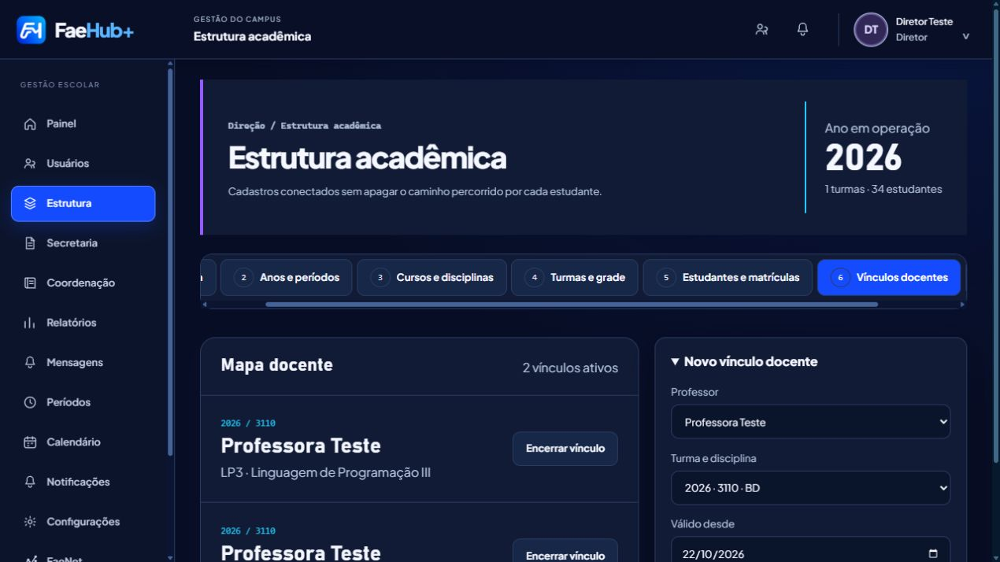

### Campos e controles

Professor, Turma e disciplina e Válido desde. O encerramento registra o fim da vigência pelo fluxo correspondente.

### Como utilizar

1. Confira a conta ativa do professor e a oferta da disciplina na turma.
2. Selecione professor e combinação de turma e disciplina e informe a data de início.
3. Clique em Criar vínculo e confira o resultado no Mapa docente.
4. Quando houver mudança de responsabilidade, encerre o vínculo anterior e cadastre o novo respeitando as datas escolares.

### Regras e cuidados

A chamada exige vínculo vigente na data da aula, não apenas um papel genérico de professor.

Encerrar vínculo preserva os registros anteriores. Não troque o nome da conta para simular uma substituição docente.

O docente mostrado na grade deriva desse cadastro; não é digitado livremente pelo aluno.

## Publicar e revisar horários semanais

Direção | /estrutura?view=schedule | UC29

Horários associa uma disciplina oferecida a dia, início, término e sala. A grade publicada alimenta as consultas e os próximos horários nos painéis.

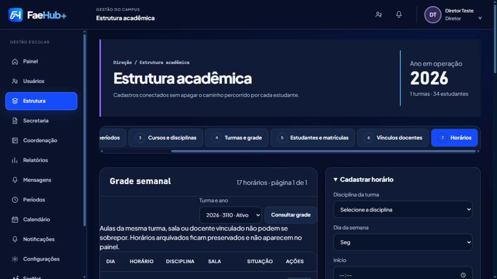

### Campos e controles

Turma e ano para consulta; Disciplina da turma, Dia da semana, Início, Término e Sala no cadastro.

### Como utilizar

1. Selecione Turma e ano e use Consultar grade para visualizar os horários existentes.
2. Em Cadastrar horário, selecione a disciplina e informe dia, início, término e sala.
3. Clique em Salvar horário e confira a linha publicada. Use Editar para ajustar um registro existente.
4. Quando um horário deixar de vigorar, utilize Arquivar. Confira a visualização do aluno e os vínculos docentes depois da manutenção.

### Regras e cuidados

O sistema verifica sobreposição de aulas da mesma turma, sala ou docente vinculado. Término deve ser posterior ao início.

Horários arquivados são preservados e deixam de aparecer nos painéis. Não altere os dias apenas para esconder uma lacuna real.

Esta é uma recorrência semanal. A chamada por aula continua sendo um registro datado e pode representar uma reposição autorizada.

## Atender e emitir documentos

Direção | /secretaria | UC30

A central de protocolos permite localizar solicitações e registrar o andamento do atendimento. O titular acompanha as atualizações na sua própria Secretaria e nos comunicados elegíveis.

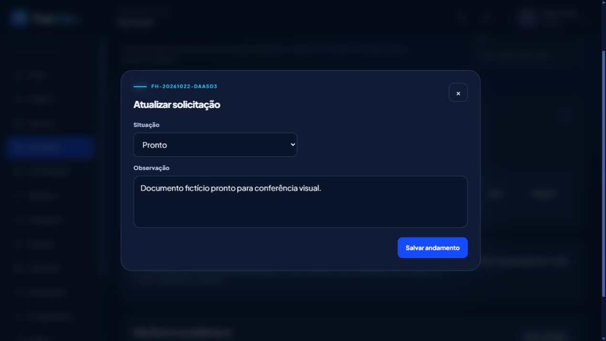

### Campos e controles

Busca por protocolo, matrícula ou solicitante. Atualização: Situação e Observação.

### Como utilizar

1. Localize o pedido na Central de protocolos e confira matrícula, tipo e finalidade.
2. Clique em Atualizar, escolha Em processamento, Pronto, Entregue ou Indeferido e escreva uma observação útil.
3. Use Salvar andamento e confira o estado exibido na lista.
4. Quando disponível, use Abrir para conferir o documento e Imprimir / salvar PDF. Marque Entregue somente após concluir a entrega pelo procedimento da escola.

### Regras e cuidados

Solicitado é o estado inicial. Atualização gera histórico de situação e pode notificar o titular.

Recuperação de senha e usuário ocorre pelo e-mail do titular; a central não precisa aprovar pedidos nem emitir códigos de acesso.

O identificador impresso é interno e não comprova assinatura digital qualificada ou validação pública externa.

## Registrar acompanhamento pedagógico

Direção | /coordenacao | UC31

Coordenação reúne alertas derivados de rendimento e frequência e permite registrar intervenções com plano de ação. O registro deve manter contexto objetivo e acesso restrito.

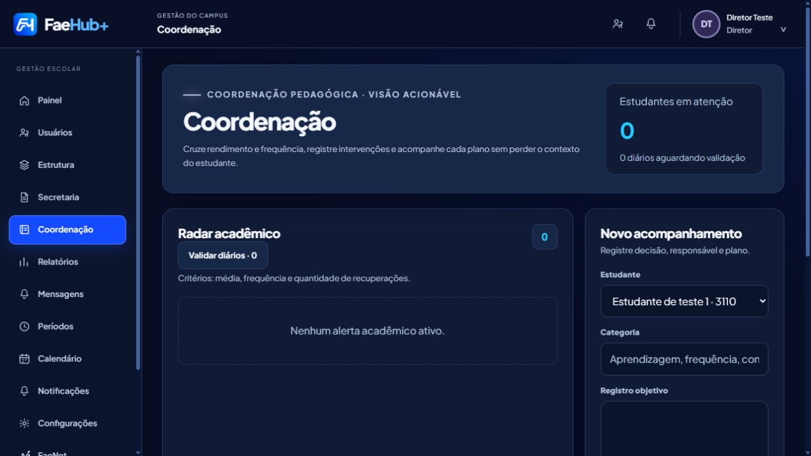

### Campos e controles

Estudante, Categoria, Registro objetivo e Plano de ação. Planos existentes têm acompanhamento de situação.

### Como utilizar

1. Consulte o Radar acadêmico e confira os registros do estudante antes de interpretar um alerta.
2. Em Novo acompanhamento, selecione o estudante e descreva categoria, ocorrência pedagógica e plano de ação.
3. Use Abrir acompanhamento e confira a entrada na lista de planos.
4. Registre as atualizações permitidas e acompanhe as situações Aberto, Em acompanhamento ou Fechado. Utilize Validar diários para acessar a fila pedagógica.

### Regras e cuidados

Indicador de atenção não é uma decisão automática nem um diagnóstico. A equipe precisa contextualizar notas e frequência.

Planos devem evitar dados sensíveis sem necessidade e registrar decisões verificáveis.

No Diário da direção, os registros enviados pelo professor podem ser validados ou devolvidos para ajustes com observação.

## Fechar e reabrir períodos

Direção | /periodos | UC32

Períodos controla a proteção dos lançamentos após fechamento. Reabrir não cria um novo período nem elimina registros: altera o estado do período existente e registra uma justificativa.

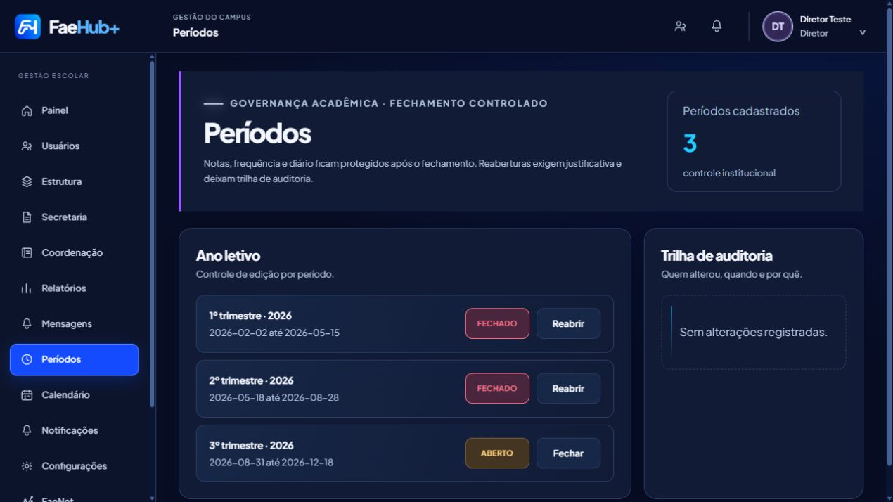

### Como utilizar

1. Confira nome, ano e datas do período antes de qualquer alteração.
2. Use Fechar em um período aberto ou Reabrir em um período fechado.
3. Informe o motivo da alteração, entre 5 e 500 caracteres, no fluxo apresentado e confirme.
4. Confira a situação atual e a Trilha de auditoria, com ação, responsável, data e motivo.

### Regras e cuidados

O fechamento protege registros alcançados pelas regras do período, inclusive chamadas e diário. A tela de notas atual não oferece uma nova divisão por bimestre.

Não reabra um período apenas para testar. A operação afeta o que pode ser alterado pela equipe.

Se a ação falhar por conflito ou estado já aplicado, atualize a página e confira a trilha antes de tentar novamente.

## Publicar eventos no Calendário

Direção publica e demais perfis consultam o público permitido | /calendario | UC33

O Calendário mantém eventos, feriados, recessos, avaliações, reuniões e conselhos, direcionados à comunidade ou a um público específico.

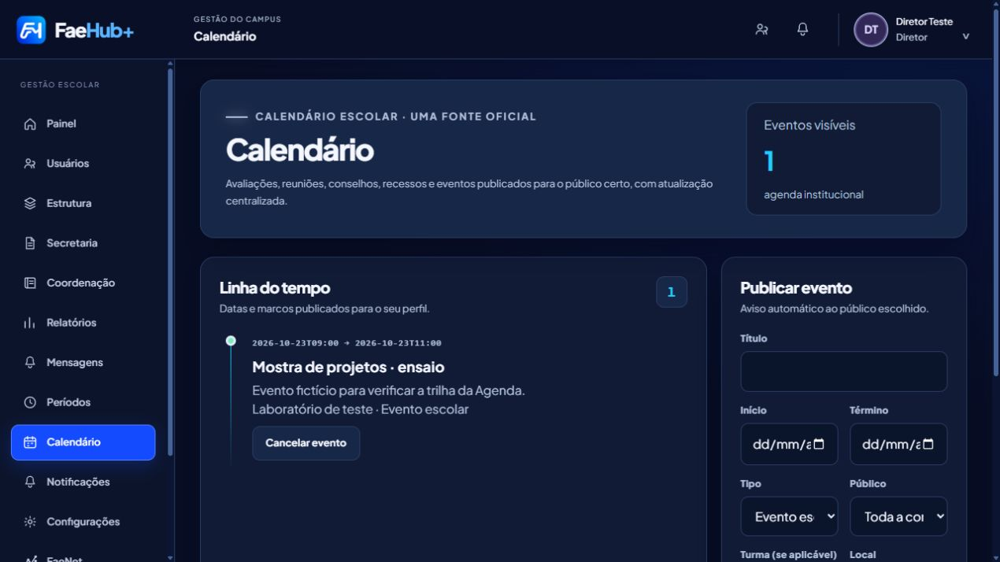

### Campos e controles

Título, Início, Término, Tipo, Público, Turma se aplicável, Local e Descrição.

### Como utilizar

1. Consulte a Linha do tempo para evitar publicação repetida ou datas conflitantes.
2. Preencha título e intervalo de data e hora, selecione o tipo e defina o público correto.
3. Para público de turma, informe a identificação da turma. Complete local e descrição e use Publicar no calendário.
4. Confira a visibilidade no perfil correspondente. Se o evento deixar de ocorrer, utilize Cancelar evento no registro adequado.

### Regras e cuidados

Professor e responsável consultam a linha do tempo autorizada; não recebem os controles de publicação da direção.

O público escolhido pode receber uma notificação. Um evento visível ao aluno não é automaticamente visível ao responsável.

Na captura local, a Agenda e a linha do tempo mostraram formatos ou conversões de hora diferentes. Confirme o fuso e a hora final publicada antes de comunicar compromissos.

## Consultar relatórios e exportar registros

Direção | /relatorios | UC34

Relatórios apresenta contadores operacionais, recorte de presença, notas, exportações CSV e trilha de atividade. Os arquivos podem conter dados pessoais e acadêmicos protegidos.

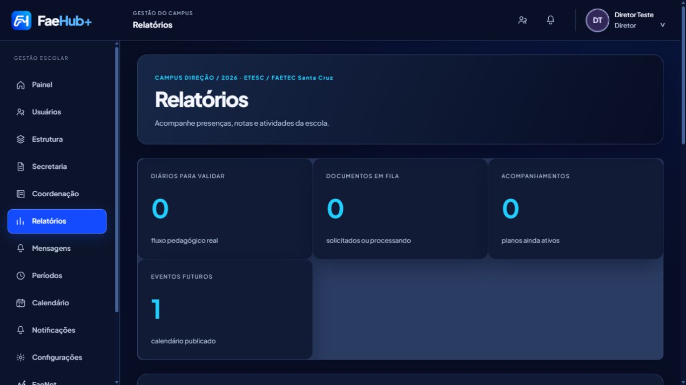

### Como utilizar

1. Consulte as filas de diários, documentos, acompanhamentos e eventos futuros.
2. Para presença, informe as datas inicial e final e use Aplicar período. Limpar remove o recorte.
3. Escolha a exportação desejada: Diário de classe, Documentos, Acompanhamentos, Presenças do período ou Notas registradas.
4. Confira a base do percentual, os registros recentes e a Trilha de atividade. Abra o CSV em uma ferramenta compatível sem compartilhar o arquivo publicamente.

### Regras e cuidados

A tabela de presença mostra até 30 registros e o CSV cobre o período completo selecionado. A trilha mostra as últimas 50 ações.

O recorte de datas se aplica a presenças. Notas incluem os lançamentos salvos, sem divisão por bimestre.

Exportação distingue presença por aula e histórico diário. Não some bases distintas para produzir um percentual único.

## Manter os dados institucionais

Direção | /configuracoes | UC35

Configurações mantém informações institucionais exibidas na central da direção. Essa tela não administra credenciais técnicas de Gmail, Drive, banco ou autenticador.

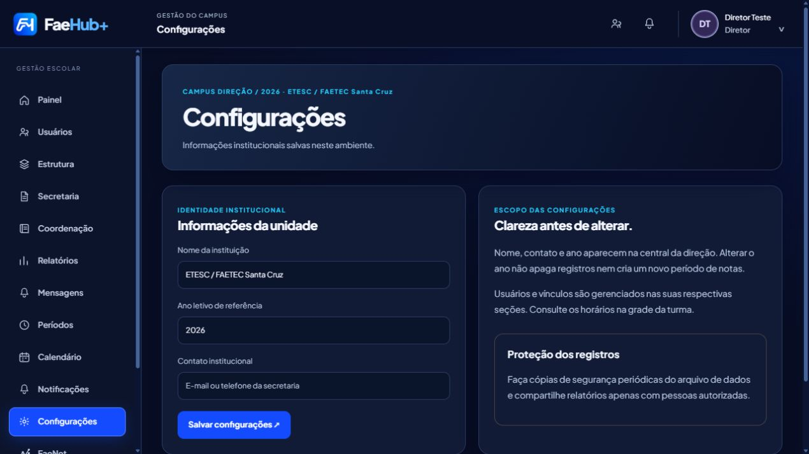

### Campos e controles

Nome da instituição, Ano letivo de referência e Contato institucional.

### Como utilizar

1. Confira os valores atuais antes de editar.
2. Informe o nome da unidade, o ano de referência e o contato institucional corretos.
3. Clique em Salvar configurações e confira os valores após a confirmação.
4. Para usuários, vínculos, turmas ou períodos, abra as áreas correspondentes em vez de tentar controlar tudo pelo ano de referência.

### Regras e cuidados

Mudar o ano de referência não apaga dados nem cria novo ano ou novo período de notas.

Segredos técnicos devem ser tratados privadamente pelo operador do servidor, nunca inseridos no contato institucional ou no manual.

O código e seu histórico no GitHub não substituem cópia de segurança do banco.

## Consultar a trajetória acadêmica

Direção e titulares conforme matrícula autorizada | /historico e resumo da Secretaria | UC36

O histórico organiza anos, turmas, curso, matrícula e resultados preservados. Ele permite acompanhar uma trajetória sem sobrescrever ciclos anteriores ao abrir um novo ano.

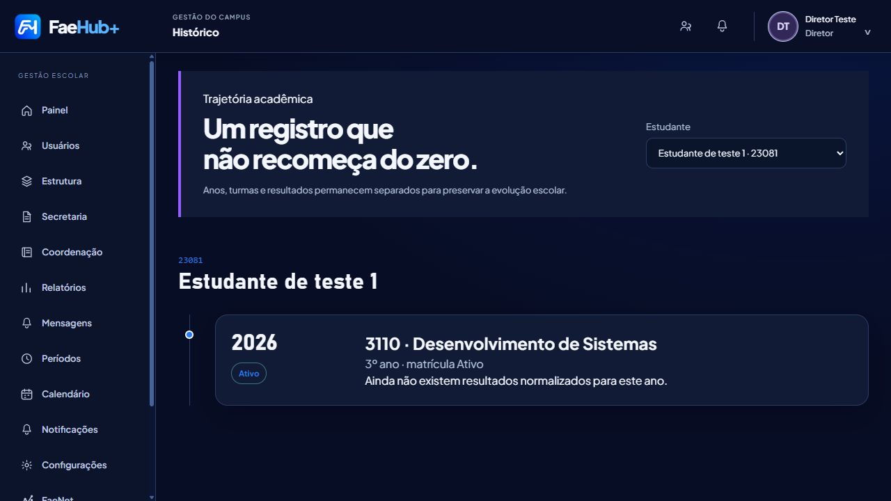

### Como utilizar

1. Na direção, abra Consultar históricos pelo Mapa da Estrutura ou Abrir consulta pela Secretaria.
2. Selecione o estudante autorizado e confira a identificação e o ano.
3. Leia a turma, a situação da matrícula e os resultados disponíveis para cada ciclo.
4. Para documento formal, solicite ou emita o tipo adequado pela Secretaria; a consulta visual não substitui a emissão.

### Regras e cuidados

Ainda não existem resultados normalizados não significa que todos os campos N1/N2 do boletim sejam zero.

O histórico normalizado e o lançamento compatível de N1/N2 têm estruturas diferentes no código atual; não há migração automática comprovada de cada lançamento para avaliações por período.

Alunos e responsáveis só devem consultar suas próprias matrículas ou vínculos autorizados.

## Acompanhar estudantes vinculados

Responsável | /painel | UC37

O Portal do responsável mostra os estudantes vinculados, sua turma, média consolidada, frequência, documentos e quantidade de acompanhamentos. Não libera a base escolar completa.

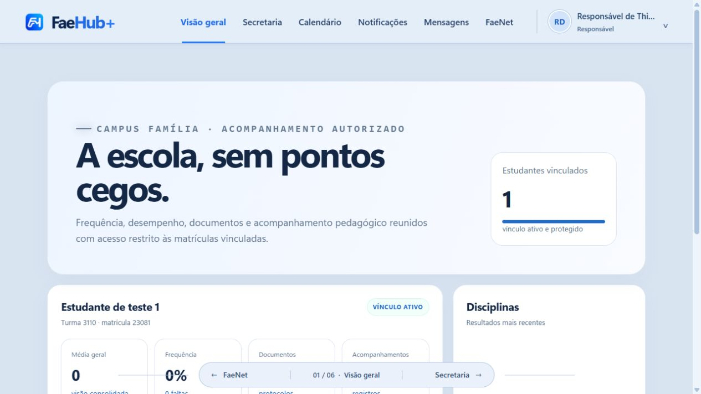

### Como utilizar

1. Entre pelo perfil Responsável com sua própria conta e confira a lista de estudantes vinculados.
2. Leia os resultados e a frequência do estudante correto, considerando se existem lançamentos e chamadas disponíveis.
3. Use Solicitar documento para abrir a Secretaria, Ver calendário para os eventos autorizados e Falar com a escola para Mensagens.
4. Se não houver matrícula vinculada, procure a escola para corrigir o cadastro. Não utilize as credenciais do estudante para contornar o vínculo.

### Regras e cuidados

No painel fotografado, acompanhamentos aparecem como contagem; não é uma tela de edição de planos pedagógicos.

O responsável não lança notas, não realiza chamada e não valida diário.

As conversas permitidas se limitam à equipe e aos estudantes vinculados. O acesso à FaeNet depende da configuração federada e da elegibilidade da identidade.

## Acessar a FaeNet pelo FaeHub

Todos os perfis elegíveis | /faenet | UC38

A tela FaeNet apresenta a comunidade escolar e atalhos para feed, conversas, exploração e mapa. Os botões abrem outra aba. O acesso unificado exige configuração coordenada nos dois aplicativos.

### Como utilizar

1. Abra FaeNet no menu e clique em Abrir a FaeNet ou no destino desejado.
2. Com a integração ativa, siga a entrada pelo FaeHub, autentique-se e conclua o autenticador se necessário.
3. Na primeira entrada da comunidade, personalize usuário, nome de exibição e, opcionalmente, foto, capa, bio e demais dados sociais. Vincular conta antiga exige a confirmação privada prevista pela FaeNet.
4. Depois, confira o destino na FaeNet. Sair dela encerra sua sessão social local, não necessariamente a sessão ainda válida do FaeHub.

### Regras e cuidados

A captura local usa o estado sem configuração federada e informa acessos independentes. Não comprova nem desmente a ativação da integração em produção.

A ponte implementada admite perfis ativos e ativados. Demos públicas não comprovam identidade para federação; um diretor não vira administrador social automaticamente.

Publicar código não ativa a integração por si só. Senha, matrícula, notas e e-mail não são enviados pela ponte de identidade descrita no projeto.

## Proteger os dados com backup

Operador autorizado | Ferramenta externa ao menu do app | UC39

Backup do banco é uma rotina operacional, não um botão disponível aos usuários escolares. O projeto contém ferramenta para criar cópia criptografada, verificar o arquivo e testar restauração em destino isolado.

### Criar e guardar

O operador utiliza tools/school_backup.py com configuração privada e, quando autorizado e configurado, envia o arquivo criptografado ao Google Drive institucional. Anexos e fotos armazenados no esquema incluído pelo dump acompanham a cópia. Credenciais e chave de criptografia devem ser guardadas fora do repositório e separadas dos backups.

### Verificar não é restaurar

verify autentica e confere a integridade do arquivo. test-restore utiliza um banco distinto e vazio e compara os registros do manifesto. O teste nunca deve ser direcionado ao banco de produção. A recuperação operacional exige ainda conferir login, histórico e downloads no ambiente restaurado.

### Agendamento neste computador

A opção escolhida para a rotina diária foi este computador, sem contratar um serviço pago. Isso exige equipamento ligado, rede, configuração privada e uma tarefa do sistema operacional efetivamente criada e conferida. Esta leitura de telas não verificou a tarefa agendada, a última cópia no Drive ou uma restauração de produção.

### Responsabilidade do operador

Defina responsável, periodicidade, retenção, destino e procedimento de emergência. O GitHub guarda código e histórico, não os registros escolares. Uma falha de envio não deve levar à exclusão da última cópia válida. Não envie arquivos de backup, segredos ou logs ao repositório.

### Regras e cuidados

Não declarar backup automático operacional apenas porque a ferramenta existe. Exigir evidências da execução e de uma restauração isolada.

Gmail envia convites e recuperação; Google Drive guarda arquivos. As duas autorizações têm finalidades diferentes.

## Resolver situações comuns

Antes de repetir uma operação, confirme a conta, o perfil, os filtros, a conexão e a situação do registro. Uma mensagem de validação deve ser lida integralmente.

| Situação | Conferência e encaminhamento |
| --- | --- |
| Não consigo entrar | Confira perfil, usuário ou e-mail e senha. Conta bloqueada exige atendimento da escola; não crie outra identidade para contornar o bloqueio. |
| Convite não chegou | Confira spam e e-mail informado. Peça reenvio à direção. A escola deve conferir o transporte de e-mail antes de declarar o convite enviado. |
| Código de recuperação falhou | Use o e-mail confirmado e o código mais recente dentro de 30 minutos. Respeite a espera por excesso de tentativas. |
| Perdi o autenticador | Use um código de recuperação privado com a senha. Sem ambos, procure o operador; recuperação de senha não remove o segundo fator. |
| Não aparece uma turma | Confira vínculo docente vigente ou matrícula ativa. Solicite correção à direção; não use a conta de outra pessoa. |
| Chamada não salva | Confira disciplina, data, início e término; marque todos os alunos. Verifique período aberto, vínculo, aula não futura e ausência de sobreposição. Recarregue em conflito de revisão. |
| Anexo não envia | Confira formato e tamanho. Use a ação final de envio e consulte a entrega ou conversa para confirmar se o arquivo ficou salvo. |
| Lista ou histórico vazio | Limpe os filtros e confira a base consultada. Sem lançamento, chamada ou resultado normalizado não significa nota zero ou falta automática. |
| Documento não abre | Confira situação do protocolo e autorização da matrícula. O arquivo emitido fica disponível conforme o estado permitido. |
| FaeNet não conclui entrada | Reabra pela entrada oficial. Conta precisa estar ativa e elegível e a ponte precisa estar configurada nos dois serviços. Não compartilhe senhas ou tokens no suporte. |
| Horário divergente | Compare grade publicada, evento e fuso. Informe a escola com a data e as telas envolvidas; não presuma que Tempo livre seja intervalo oficial. |

### Regras e cuidados

Ao pedir ajuda, informe perfil, área, ação, data e texto do erro. Use capturas sem senhas, códigos, dados pessoais desnecessários ou informações de terceiros.

O manual descreve caminhos e regras; não certifica que todos os serviços externos estejam operacionais na instalação de produção.

## Roteiros para o uso cotidiano

### Aluno antes da aula

Entre com sua conta, confira a próxima aula no Painel e abra Horário para distinguir aula de tempo livre. Consulte Agenda e Comunicados. Em Exercícios, filtre Pendentes e prepare as respostas e anexos pedidos.

### Professor durante a rotina

Abra Minhas turmas, confira o vínculo e acesse Chamada. Selecione data, disciplina e horários, marque todos, salve e recarregue. Registre conteúdo no Diário e envie para validação. Corrija entregas no estúdio e consolide N1/N2 separadamente quando aplicável.

### Direção no atendimento

Consulte as filas no Painel. Atenda protocolos na Secretaria, valide ou devolva diários e acompanhe planos na Coordenação. Antes de alterar vínculos, matrículas ou períodos, confira as datas e os efeitos sobre a rotina. Exporte somente os dados necessários para pessoas autorizadas.

### Responsável no acompanhamento

Confirme o estudante e a matrícula no Portal, leia os resultados e utilize os atalhos de documentos, calendário e mensagens. Solicite correção de vínculo à escola se o estudante não aparecer; não compartilhe senhas familiares.

### Ao terminar

Confira o resultado das ações que salvou, guarde documentos e exportações em local adequado e saia da conta em equipamentos compartilhados. Para recuperar acesso, use o e-mail confirmado. Para perda do segundo fator, siga a recuperação privada sem publicar códigos.

## Casos de uso de acesso e serviços

Titular representa os perfis com acesso permitido. Gmail participa de convite e recuperação; FaeNet é o aplicativo de destino; Drive é destino opcional da cópia criptografada. Backup é uma ferramenta operacional externa ao menu. As associações indicam participação, não sequência de execução.

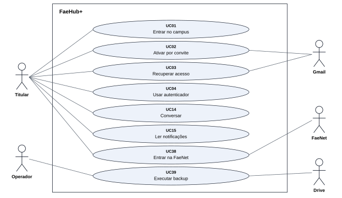

## Casos de uso acadêmicos

Aluno consulta seus registros e entrega atividades. Professor registra a aula, a presença, as notas e a correção. Responsável participa da solicitação para matrículas vinculadas e consulta resultados pelo seu portal, não pela edição de notas. Autenticação e vínculos válidos são pré-condições dos casos protegidos.

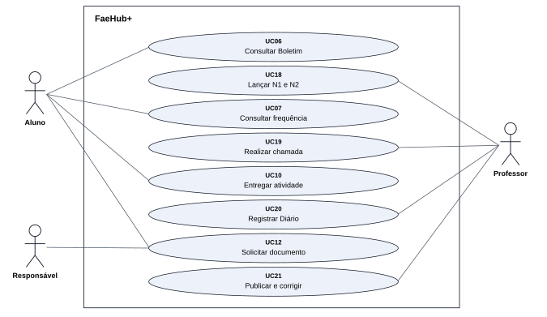

## Casos de uso da gestão escolar

A direção mantém cadastros e atende os fluxos institucionais. O titular acompanha o documento solicitado. Algumas elipses agrupam casos relacionados para manter a visão legível; os identificadores individuais constam do catálogo. Não há uma etapa de aprovação da direção na recuperação por e-mail.

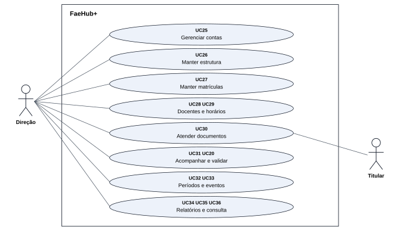

## Classes do núcleo acadêmico

Modelo conceitual UML baseado em academic_core.py e database.py. A linha contínua representa associação; as multiplicidades aparecem entre as classes. As associações referem-se ao modelo de domínio, e não a herança entre papéis. Estudante e conta são distintos; uma matrícula ativa liga o estudante a uma turma.

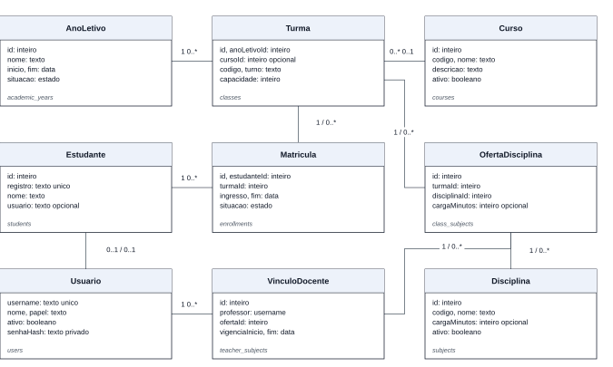

## Classes de aulas e resultados

Linha contínua: associação estrutural. Linha tracejada: relação lógica ou por código legado, sem afirmar uma chave estrangeira direta. A frequência atual relaciona Aula e Matricula. LancamentoNota representa o fluxo N1/N2 de grades; não deve ser confundido com assessments e assessment_scores, estruturas normalizadas presentes no projeto. /media é um valor derivado.

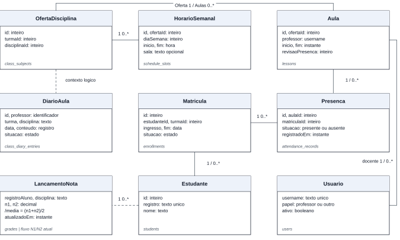

## Classes de aprendizagem e serviços

Recorte conceitual dos principais registros de database.py e p1_operations.py. Anexo é polimórfico: tipoEntidade e entidadeId identificam mensagem, atividade ou entrega; as linhas tracejadas não são FKs diretas. Usuario também aparece nos atributos de autoria, solicitação e destinatário. Os vínculos auxiliares e o controle de leitura são detalhados na página seguinte.

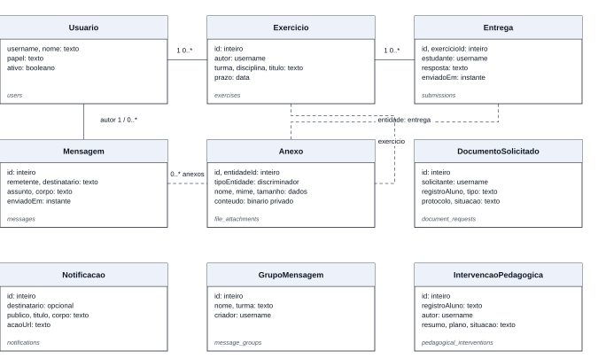

## Correspondência entre classes e implementação

### Representação do domínio

As classes dos desenhos descrevem conceitos e atributos persistidos. A implementação é predominantemente procedural: rotas Flask chamam funções que consultam tabelas e retornam dicionários. Portanto, os desenhos não são diagramas de herança de classes Python e não inventam métodos orientados a objetos.

### Cardinalidades e vínculo acadêmico

Um ano tem muitas turmas e períodos; um curso pode ter várias turmas. Turma e disciplina se relacionam por OfertaDisciplina. Um estudante pode acumular matrículas históricas, com apenas uma ativa. O professor é um Usuario com papel e vínculo de vigência, não uma subclasse Python de Estudante.

### Notas e frequência

O fluxo visível de N1/N2 usa grades com chave por registro do estudante e disciplina. As estruturas assessments e assessment_scores usam avaliação, período e matrícula no modelo normalizado, mas não equivalem automaticamente ao fluxo atual. attendance mantém a base diária anterior; lessons e attendance_records são a base da chamada por aula.

### Associações auxiliares

message_group_members vincula Usuario e GrupoMensagem; message_receipts registra entrega e leitura por mensagem e usuário; message_reactions registra reação por usuário. submission_reviews relaciona uma correção à entrega e preserva o texto da resposta corrigida. notification_reads e communication_states mantêm leitura por conta; leitura não é atributo global do conteúdo.

### Identidade e segurança

account_identities liga a conta ao e-mail confirmado. account_invitations registra o convite e seu estado. account_mfa e mfa_recovery_codes tratam segundo fator e códigos protegidos. faenet_subjects e faenet_grants sustentam a ponte de identidade. Estes registros não devem ser publicados em capturas ou exportações de documentação.

### Limites das associações lógicas

Documento e Intervencao utilizam identificação do estudante por texto; diário contém turma e disciplina por código; Anexo utiliza tipo e id de entidade. Uma linha tracejada indica essa relação lógica, sem alegar uma FK, composição, exclusão em cascata ou herança inexistente. O diagrama é um recorte dos registros principais, não um inventário de todas as tabelas técnicas.

## Catálogo de casos de uso

| Caso | Objetivo | Ator | Resultado |
| --- | --- | --- | --- |
| UC01 | Entrar e sair do campus | Todos os perfis | Sessão do perfil autorizado |
| UC02 | Ativar uma conta por convite | Titular convidado | E-mail confirmado e conta ativada |
| UC03 | Recuperar senha ou nome de usuário | Titular com e-mail confirmado | Identificação enviada ou senha redefinida |
| UC04 | Utilizar o autenticador da conta | Todos os titulares ativados | Segundo fator confirmado |
| UC05 | Consultar o painel do aluno | Aluno | Resumo da rotina acadêmica consultado |
| UC06 | Ler e imprimir o Boletim | Aluno | Notas por disciplina consultadas ou impressas |
| UC07 | Acompanhar Agenda e frequência | Aluno | Chamadas e eventos do mês consultados |
| UC08 | Interpretar a grade de horários | Aluno | Aulas e lacunas da grade identificadas |
| UC09 | Buscar atividades e consultar devolutivas | Aluno | Atividade e devolutiva localizadas |
| UC10 | Entregar uma atividade com anexo | Aluno | Resposta ou anexo salvo na atividade |
| UC11 | Ler e organizar os Comunicados | Aluno | Leitura registrada para a conta |
| UC12 | Solicitar e acompanhar documentos | Aluno e responsável autorizado | Protocolo registrado ou documento consultado |
| UC13 | Consultar oportunidades de estágio | Aluno | Condições e canal de inscrição consultados |
| UC14 | Conversar com pessoas e grupos | Todos os perfis conforme contatos autorizados | Mensagem ou anexo registrado na conversa |
| UC15 | Gerenciar notificações da conta | Professor direção e responsável | Histórico consultado ou leitura registrada |
| UC16 | Organizar o trabalho pelo painel docente | Professor | Prioridades docentes consultadas |
| UC17 | Consultar as turmas vinculadas | Professor | Lista da turma autorizada localizada |
| UC18 | Lançar e corrigir notas | Professor com vínculo válido | N1/N2 da linha persistidas |
| UC19 | Realizar a chamada por aula | Professor com vínculo vigente | Presenças salvas para uma aula |
| UC20 | Registrar e enviar o Diário | Professor | Registro pedagógico salvo ou validado |
| UC21 | Publicar atividades e corrigir entregas | Professor | Atividade publicada ou entrega corrigida |
| UC22 | Publicar e arquivar avisos da turma | Professor | Comunicado da turma publicado ou arquivado |
| UC23 | Publicar oportunidades profissionais | Professor | Anúncio publicado para a turma |
| UC24 | Acompanhar o observatório da direção | Direção | Indicadores e filas institucionais consultados |
| UC25 | Gerenciar contas e convites | Direção ativada e proprietário conforme autorização | Conta ou convite gerenciado |
| UC26 | Organizar a estrutura acadêmica | Direção | Cadastros ligados ao ciclo letivo |
| UC27 | Cadastrar estudantes e matrículas | Direção | Matrícula criada ou encerrada com histórico |
| UC28 | Definir vínculos docentes | Direção | Vínculo e vigência registrados |
| UC29 | Publicar e revisar horários semanais | Direção | Horário publicado sem sobreposição |
| UC30 | Atender e emitir documentos | Direção | Andamento do protocolo atualizado |
| UC31 | Registrar acompanhamento pedagógico | Direção | Plano pedagógico registrado e acompanhado |
| UC32 | Fechar e reabrir períodos | Direção | Estado do período e motivo registrados |
| UC33 | Publicar eventos no Calendário | Direção publica e demais perfis consultam o público permitido | Evento publicado para o público escolhido |
| UC34 | Consultar relatórios e exportar registros | Direção | CSV do recorte disponibilizado |
| UC35 | Manter os dados institucionais | Direção | Identidade institucional atualizada |
| UC36 | Consultar a trajetória acadêmica | Direção e titulares conforme matrícula autorizada | Trajetória consultada por estudante |
| UC37 | Acompanhar estudantes vinculados | Responsável | Dados do estudante vinculado consultados |
| UC38 | Acessar a FaeNet pelo FaeHub | Todos os perfis elegíveis | Sessão social autorizada se a ponte estiver ativa |
| UC39 | Proteger os dados com backup | Operador autorizado | Cópia protegida e evidência de verificação |

## Fluxos e alternativas dos casos críticos

### UC10 Entregar atividade

**Pré-condições**: Aluno autenticado, matriculado e autorizado à atividade ativa.

**Fluxo principal**: Abrir a atividade; ler o enunciado; preencher resposta ou selecionar arquivo válido; enviar; conferir a entrega ao reabrir.

**Alternativas**: Sem conteúdo, formato inválido ou excesso de tamanho: revisar o formulário. Prazo vencido: o sistema admite envio e informa que a aceitação depende do professor. Falha de rede: consultar antes de reenviar.

**Pós-condição**: Resposta e anexo ficam ligados à atividade e ao aluno; o envio não atribui nota automaticamente.

### UC19 Realizar chamada

**Pré-condições**: Professor autenticado com vínculo vigente; turma e ano ativos; matrícula abrangendo a data e um único período aberto.

**Fluxo principal**: Consultar turma e data; selecionar disciplina e início/fim; carregar se existente; marcar todos; salvar; recarregar a mesma aula.

**Alternativas**: Futuro, sobreposição, intervalo inválido ou seleção incompleta: corrigir antes de salvar. Revisão desatualizada: recarregar. Aula de outro docente ou término incompatível: procurar o responsável, sem sobrescrever silenciosamente.

**Pós-condição**: Aula e presenças ficam registradas com revisão; aulas distintas no mesmo dia permanecem independentes.

### UC25 Gerenciar convites

**Pré-condições**: Direção pessoal ativada, permissão adequada e transporte de e-mail configurado.

**Fluxo principal**: Pesquisar a conta; preparar os dados corretos e o vínculo; enviar convite; titular abre o e-mail e ativa com senha pessoal.

**Alternativas**: Demo ou identidade inicial não ativada: não convidar como direção confirmada. Falha de envio: cadastro preparado não equivale a convite entregue. Convite vencido ou revogado: emitir novo conforme o fluxo.

**Pós-condição**: Convite e conta mantêm estado verificável; senha continua privada do titular.

### UC30 Atender documento

**Pré-condições**: Direção autenticada e pedido existente; solicitante com matrícula autorizada.

**Fluxo principal**: Localizar protocolo; conferir a solicitação; atualizar situação e observação; salvar; abrir quando disponível; registrar entrega quando concluída.

**Alternativas**: Dados divergentes: conferir com solicitante. Indeferimento: registrar observação. Sem autorização ou documento não disponível: não contornar o acesso com outro usuário.

**Pós-condição**: Andamento persiste por protocolo e o titular acompanha a atualização no seu contexto.

### UC38 Entrar na FaeNet

**Pré-condições**: Conta ativa, ativada e elegível; configuração coordenada nos dois aplicativos e serviços disponíveis.

**Fluxo principal**: Abrir FaeNet; autenticar pelo FaeHub; concluir MFA se ativo; na comunidade, personalizar perfil ou confirmar vínculo antigo; abrir destino permitido.

**Alternativas**: Ponte não configurada: interface pode exibir acesso independente. Demo pública ou conta bloqueada: não libera identidade federada. Erro de vínculo: reabrir a entrada oficial; não mesclar por nome coincidente.

**Pós-condição**: FaeNet recebe identidade mínima autorizada, sem senha ou registros acadêmicos; permissões escolares não viram administração social.

## Fontes e cobertura da leitura

Navegação de referência: 55 enquadramentos de login, recuperação, ativação, quatro perfis, consultas, cadastros e formulários. Foram fotografadas telas e abertos detalhes sem modificar dados de produção. O inventário navegacao.json registra perfil, título e endereço observado; os arquivos de captura são os originais do navegador.

Rotas e menus: app.py, templates/base.html e templates das áreas observadas. Núcleo acadêmico: academic_core.py e school_timetable.py. Registros compatíveis: database.py. Chamada: lesson_attendance.py. Estúdio docente: teacher_studio.py. Serviços escolares: p1_operations.py.

Identidade e acesso: account_enrollment.py, account_recovery.py, account_mfa.py, profile_photos.py e faenet_sso.py. Rotina de backup: backup_service.py e tools/school_backup.py. Contratos complementares: docs/faenet-sso.md e docs/attendance-security-backup.md.

Configuração do ensaio: banco descartável local, e-mail desabilitado e sem chave de MFA ou segredo de federação. Não houve confirmação de entrega Gmail, entrada social federada, tarefa diária, upload Drive ou restauração de produção nesta documentação. Esses fluxos são descritos com os requisitos do projeto, não certificados pela imagem da tela.

O formulário de correção foi conferido no template e no fluxo implementado; a lista capturada estava sem entregas. QR, códigos de recuperação, senha nova e convites privados não foram fotografados. Estados não alcançados na navegação foram descritos pelas regras do código e não apresentados como operações executadas.

Escopo visual: desktop no enquadramento padrão do navegador. O manual não inclui uma certificação de acessibilidade ou uma matriz de testes de dispositivos. As pranchas conceituais enviadas na conversa não foram usadas como substitutas das capturas reais.

Manutenção: atualize conteudo.json, refaça capturas afetadas, execute tools/build_user_documentation.py no runtime de documentos e revise as páginas do PDF. Segredos, bancos, logs e os estados brutos de navegação não fazem parte do material a publicar.

## Índice de capturas do manual

| Figura | Tela | Arquivo |
| --- | --- | --- |
| 1 | Entrar e sair do campus | 01-login.jpg |
| 2 | Ativar uma conta por convite | 03-ativacao.jpg |
| 3 | Recuperar senha ou nome de usuário | 02-recuperacao.jpg |
| 4 | Utilizar o autenticador da conta | 14-seguranca.jpg |
| 5 | Navegar e personalizar a identificação | 04-aluno-painel.jpg |
| 6 | Consultar o painel do aluno | 04-aluno-painel.jpg |
| 7 | Ler e imprimir o Boletim | 05-aluno-boletim.jpg |
| 8 | Acompanhar Agenda e frequência | 06-aluno-agenda.jpg |
| 9 | Interpretar a grade de horários | 07-aluno-horario.jpg |
| 10 | Buscar atividades e consultar devolutivas | 08-aluno-exercicios.jpg |
| 11 | Entregar uma atividade com anexo | 15-entrega.jpg |
| 12 | Ler e organizar os Comunicados | 09-aluno-comunicados.jpg |
| 13 | Solicitar e acompanhar documentos | 10-aluno-secretaria.jpg |
| 14 | Consultar oportunidades de estágio | 11-aluno-estagios.jpg |
| 15 | Conversar com pessoas e grupos | 16-mensagens-grupo.jpg |
| 16 | Gerenciar notificações da conta | 27-notificacoes.jpg |
| 17 | Organizar o trabalho pelo painel docente | 18-professor-painel.jpg |
| 18 | Consultar as turmas vinculadas | 19-professor-turmas.jpg |
| 19 | Lançar e corrigir notas | 20-professor-notas.jpg |
| 20 | Realizar a chamada por aula | 21-professor-chamada.jpg |
| 21 | Registrar e enviar o Diário | 22-professor-diario.jpg |
| 22 | Publicar atividades e corrigir entregas | 52-criar-atividade.jpg |
| 23 | Publicar e arquivar avisos da turma | 53-criar-aviso.jpg |
| 24 | Publicar oportunidades profissionais | 54-criar-estagio.jpg |
| 25 | Acompanhar o observatório da direção | 28-diretor-painel.jpg |
| 26 | Gerenciar contas e convites | 29-diretor-usuarios.jpg |
| 27 | Organizar a estrutura acadêmica | 30-diretor-estrutura.jpg |
| 28 | Cadastrar anos e períodos letivos | 38-estrutura-anos.jpg |
| 29 | Manter cursos e disciplinas | 39-estrutura-catalogo.jpg |
| 30 | Cadastrar turmas e compor grades | 40-estrutura-turmas.jpg |
| 31 | Cadastrar estudantes e matrículas | 41-estrutura-matriculas.jpg |
| 32 | Definir vínculos docentes | 42-estrutura-docentes.jpg |
| 33 | Publicar e revisar horários semanais | 43-estrutura-horarios.jpg |
| 34 | Atender e emitir documentos | 45-secretaria-atualizar.jpg |
| 35 | Registrar acompanhamento pedagógico | 32-diretor-coordenacao.jpg |
| 36 | Fechar e reabrir períodos | 34-diretor-periodos.jpg |
| 37 | Publicar eventos no Calendário | 35-diretor-calendario.jpg |
| 38 | Consultar relatórios e exportar registros | 33-diretor-relatorios.jpg |
| 39 | Manter os dados institucionais | 36-diretor-configuracoes.jpg |
| 40 | Consultar a trajetória acadêmica | 44-diretor-historico.jpg |
| 41 | Acompanhar estudantes vinculados | 47-responsavel-painel.jpg |
| 42 | Acessar a FaeNet pelo FaeHub | 13-faenet.jpg |
